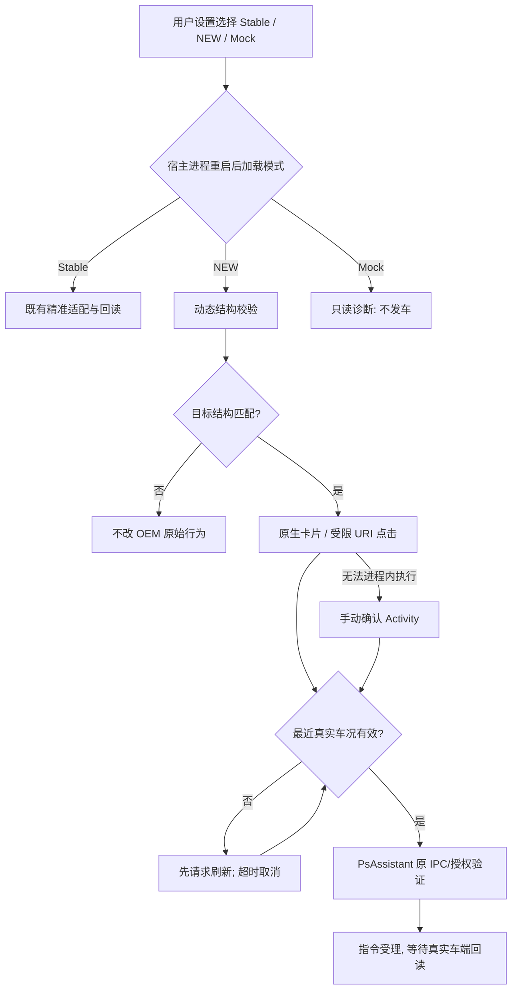

> **交付状态更新**：Beta46 新源码已通过 GitHub Android CI、Lint 和 558 项自动化测试，离线 FULL 已完成同证书 v2/v3 签名。实际中国区登录和 OEM 车辆控制仍需真机验收。详见 [构建报告](PSASSISTANT_BETA46_BUILD_VERIFICATION_20261105.md)。

# PsAssistant Beta46 — OPPO CarLink / LSPosed 双方案融合实施说明

**版本目标**：PsAssistant `v1.0.0-beta46`（code 160）、OPPO Bridge `v2.4.0`（code 37）。

**源码基准**：Beta45 Android 主分支 `5af208b3ebdcbb919996d97d0e481a48c5d3b7a0`，结合用户提供的 `psassistant_oppo_carlink-gemini1.md` 和 `粘贴的文本 (1)(9).txt`。上传材料属于候选技术设计，不是已在 OPPO 官方 SDK 与实机验证的 API 契约。

## 一、九项已经确认的融合选择

| 编号 | 选择 | Beta46 行为 | 验证边界 |
|---|---|---|---|
| 1 | **B** | OPPO Watch Indicator 的手机通知、模拟发送及诊断均在主 APK 的「OPPO 系统兼容」；`oppoWatchIndicator` 不再加入 Gradle 编译 | 手机端不能自动安装手表应用；无法以手机通知证明表盘 Indicator 成功 |
| 2 | **A** | 内置 LSPosed 单模块提供 `stable` 和 `new` 两套 Hook 安装入口，复用受控 PsAssistant IPC | 两套不会在同一宿主进程同时注入；需重启目标宿主后生效 |
| 3 | **A** | NEW 负一屏不再固定检查 `17.14.60`，动态定位已知管理类，并要求唯一、非静态、零参数 `ArrayList` getter；HomeCard 仍做精确类/方法/字段检查 | 无对应目标类、方法歧义或结构不一致时保持 OEM 原始行为 |
| 4 | **A** | NEW 在 AssistantScreen 宿主中拦截**仅 PsAssistant 自己的** `VIEW psassistant-...://command` 意图；优先走 `BridgeClient` 受控命令票据，回退 `OppoShortcutConfirmActivity` | 绝不将 `accepted` 当作“车已执行成功”；Activity 的外部 DeepLink 必须人工确认 |
| 5 | **A** | RPK 可切换原先严格文件尺寸/SHA 验证与 NEW 特征型安全补丁；只限已知 4×2/2×2 index.js，并要求 JS 特征锚点唯一和输出验证 | NEW 无明确特征时拒绝补丁，不修改磁盘 RPK/APK；2×2 未通过特征时不强行注入 |
| 6 | **A** | 模块提供真实与隔离 Mock；Mock 只读探针，不安装真实控车 Hook；NEW 不覆盖 `safe.IOT`/PMS 全局权限、不伪造 OEM 已绑定结果 | “虚拟会话/本地卡片”不是 OPPO 官方授权。上传 TXT 里的全局授权钩子、假 VIN、强制成功返回不进入活跃路径 |
| 7 | **A** | NEW 点击控车先取得真实、非 Demo、同车辆有效缓存；状态超过 5 分钟即申请刷新，最长等待约 12 秒，不能核对则取消 | 不用旧状态决定 lock/climate/air/trunk Toggle；不做乐观控车成功显示；主程序原安全回读保持不变 |
| 8 | **A** | 「OPPO 系统兼容」统一切换 Stable/NEW/Mock 三种模式，并独立选择 RPK 精确/特征验证 | 显示「已选择模式」与「宿主真实回报模式」，更换后提示重启目标进程 |
| 9 | **A** | 一键只读全项目诊断 + MyDevices、AssistantScreen、CarLink、RPK、Session、IPC 和当前模式单项诊断；一键恢复 Stable+精确 RPK | 验证不会自动执行锁车、空调、鸣笛、闪灯、改权限或假设 OPPO SDK 已授权 |

## 二、主要源码目录和实际改动

| 文件 | 改动要点 |
|---|---|
| `oppoBridge/.../OppoBridgeModule.java` | 安装前按 `BridgeSettings.compatibilityMode` 选择 Stable/NEW/Mock；NEW 调用独立适配入口，Mock 只读；真实模式不运行旧宽范围 PMS/SQLite 授权模拟 |
| `oppoBridge/.../BridgeSettings.java` | 三模式与 RPK 策略的持久化、跨进程读取、默认 Stable/Exact、非法模式回退 Stable |
| `oppoBridge/.../BridgeSettingsProvider.java` | 同 UID `update-mode` 写入，返回 `restartRequired=true`；其他宿主只能读取 |
| `oppoBridge/.../AssistantScreenNativeVehicleHook.java` | 原入口保留严格版本；新增 `installNew` 唯一方法结构匹配及原始结果回退 |
| `oppoBridge/.../NativeHomeCardHook.java` | 原入口保留严格版本；NEW 仅针对本模块车辆行，仍要求类、字段、方法形状匹配 |
| `oppoBridge/.../AdaptiveQuickAppRpkPatch.java` | NEW 4×2/2×2 有界内存补丁，Exact/Feature 可切换，任何不匹配返回原字节 |
| `oppoBridge/.../QuickAppCarCapability.java` | `patchFeature` 验证唯一 `eventSummary`、`clickEvent`、CAR 控件与补丁长度 |
| `oppoBridge/.../AdaptiveShelfShortcutInterceptor.java` | 仅拦截自有 Scheme + 指令白名单，验证真实快照并从主程序申请车控，拒绝旧缓存/Mock |
| `oppoBridge/.../OppoShortcutConfirmActivity.java` | 可由 OEM DeepLink 打开的回退 Activity，**必须手动确认**且重新核对快照 |
| `oppoBridge/.../BridgeModeReporter.java` | 宿主进程上报实际激活的模式与时间，不包含 VIN、账号或 Token |
| `app/.../PsAssistantBridgeProvider.java` | 独立记录已授权宿主的模式回报，并仅允许允许的宿主/进程发送诊断信息 |
| `app/.../OppoBridgeModeDiagnostics.java` | 显示实际观测到的各宿主模式、时间、新旧模式差异 |
| `app/.../OppoSystemCompatActivity.java` | 「OPPO 系统兼容」独立模式选择、NEW RPK 策略、逐项诊断、完整检测与恢复 Stable |
| `app/.../OppoWatchIndicatorLab.java` | 手机端独立通知测试，明确不等于表盘本地通知 |
| `android-app/settings.gradle` | 去除单独 `oppoWatchIndicator` 的 Gradle include，不再为方案 1B 编译手表 APK |
| `AndroidManifest.xml` | 新的手动确认 DeepLink Activity 注册；原内置 VehicleShortcutActivity 仍不对外直接暴露 |
| `app/build.gradle`、`oppoBridge/build.gradle` | 主程序 code 160，Bridge code 37 |

## 三、实际调用和回退路径

模式切换写入同 UID BridgeSettings Provider，已注入到宿主的 Hook **不能热卸载**：必须重启 AssistantScreen、MyDevices（包括 :cards）、CarLink 等对应进程才能完全切换。设置中的已选择值不冒充「当前生效」。

## 四、权限、安全与真实性

1. **禁止**在生产/真实模式中对整个 `system_server` 的 `checkPermission`、`checkCallingPermission` 直接返回 `PERMISSION_GRANTED`；上传 TXT 方案中的全局 PMS/ContextImpl Hook 不纳入本次活动代码。
2. **禁止**给 OEM SQLite 所有 car/whitelist 查询合并一行伪车辆、伪 VIN 或强制返回已绑定；不以虚拟 Local Session 冒充 OPPO 官方已绑定。
3. **禁止**不经验证将任意 `dispatchCarEvent` 设置成功，禁止 `param.setResult(true)` 替代车端回读。
4. NEW 模式仅处理有结构签名的本地卡片、特定 RPK JavaScript 片段和本应用命令 URI。失败返回 OEM 原逻辑。
5. 默认 Stable + Exact；NEW 与特征补丁为显式实验。Mock 模式不可向真实车辆发出车控指令。
6. 外部 DeepLink 不能静默执行，需 `OppoShortcutConfirmActivity` 里明确用户确认；所有真实命令走主程序既有权限会话与回读。
7. 任何 SDK、LSPosed Hook、卡片出现，都不能用作 OPPO 官方授权、车辆已绑定或控车实际成功的证明。

## 五、验收计划

### A. 源码/构建

- 主 APK 和 OPPO Bridge 可用 Java 17、Android SDK35、Gradle8.7 编译；`oppoWatchIndicator` 不参加构建。
- Manifest 解析正确；Debug APK 的 `classes.dex`、资源和签名完整。
- 项目里包括 `Beta46CarLinkDualModeTest` / `Beta46ModeDiagnosticsTest`，覆盖模式非法值回退、白名单 URI、缓存时效、特征补丁、不能重入补丁、未经验证的宿主状态。

### B. 手机实机/模拟状态

| 测试 | 验收 |
|---|---|
| 选择 Stable → 重启宿主 | 实际回报 Stable；旧版卡片正常 |
| 选择 NEW → 重启宿主 | 实际回报 NEW；动态匹配成功或明确未匹配回退 |
| 选择 Mock | 实际回报 Mock；无任何远控 Hook 安装 |
| 仅切换设置、不重启宿主 | 明确提示生效模式仍为旧值 |
| MyDevices 主/卡进程 | Hook 进程分别可见，卡片按钮只属于 PsAssistant 行 |
| RPK Exact / Feature | 已知 SHA 精确生效；未知结构不触发；特征适配不得污染其它应用卡片 |
| 负一屏四键 | 点击锁/空调/净化/尾门后显示“请求已受理/等待回读”，非成功假提示 |
| 旧车况、跨 VIN、Demo | 禁止直接 Toggle，先请求真实状态；未确认则取消 |
| Activity 回退 URI | 需要手动确认且通过缓存与授权校验，关闭对话框后不发指令 |
| Mock 一键测试 | 所有指标与真实模式隔离，不实际解锁、鸣笛、开空调、闪灯 |
| 一键恢复 Stable | 设置即时回到 Stable + Exact；宿主重启后当前回报吻合 |

### C. 本轮无法以代码测试代替的项目

- OPPO 官方 CarLink SDK/Smart Controls 正式授权、safe.IOT 签名权限及真正系统绑定；
- ColorOS 17 具体不同 OTA 版本的 RPK 与 native `DeviceInfo` 反射结构；
- 有 Root + LSPosed 的 OPPO 真机上是否能无跳转控车，及实际 Polestar 指令服务器回读；
- OPPO Watch 本机表盘 Indicator：Beta46 按 1B 只提供手机测试，不提供表端 APK；
- 正式 FULL 独立登录：必须使用已成功编译的新 APK、批准的本地客户端资源及与旧 FULL 一致的签名，不能用旧 Beta45 APK 重新标注 Beta46 冒充完工。

## 六、编译/交付状态说明

代码提交应以此已验证源码为基准；本地容器环境如果缺少 Android SDK、Gradle 及 GitHub 连接，**源码检查与部分 Java 算法测试不等于完整 Android 构建或 APK 交付**。`v1.0.0-beta46` 在实际 CI 构建通过并产生新产物前不可称作 FULL 编译成功。
