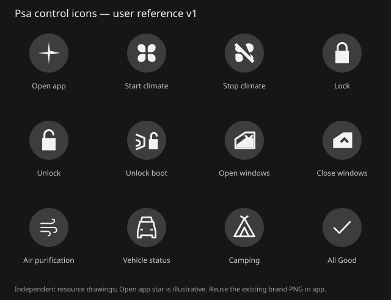

# Psa 按钮图标设计规范 v1

2026-10-27。依据用户新增的控制中心截图及 PSeu Widget 图片，作为本 Android 分支所有皮肤、Widget 和后续按钮的统一参考。该增量优先于 v5 中与这些控制图标不一致的旧示意；品牌基础排版、配色与真实性规则仍沿用 Psa VI v5。

## 母版与证据

这是依据用户提供图片制作的**独立实现资源**，不是官方原始矢量母版。App 开启图标复用仓库现有 brand_light / brand_dark PNG；桌面启动器继续使用用户指定的黑武士图标。不得把控制中心星形图标替换成启动器图标，也不改变已有车辆图片比例。

## 资源映射

| 功能 | Android 公用资源 | 图形约定 |
|---|---|---|
| Open app | brand_light / brand_dark | 复用现有星形资源，等比显示 |
| Start climate | ic_climate.xml | 四叶实心风扇 |
| Stop climate | ic_climate_off.xml | 同族风扇加斜向停止标记 |
| Lock | ic_lock.xml | 实心锁体、闭合锁梁 |
| Unlock | ic_unlock.xml | 相同锁体、打开的锁梁 |
| Unlock boot | ic_tailgate.xml | 尾部轮廓与小解锁标记 |
| Open windows | ic_window.xml | 车窗轮廓与向下标记 |
| Close windows | ic_window_close.xml | 相同外形与向上留白标记 |
| Air purification | ic_air.xml | 风流符号，与风扇保持接近的视觉尺寸 |
| Vehicle status | ic_status.xml | 车辆正面线形图标 |
| Camping | ic_camp.xml | 同线宽帐篷图标 |
| All Good | ic_check.xml | 独立矢量勾，配 All Good！ |

同一功能只能维护一个公用 drawable；主程序、设置预览、Widget 直接复用，不能各自画一个比例不同的近似图。没有可用后端的动作不能仅因有图标就添加可执行指令。

## 尺寸与布局

- 矢量统一 24×24 viewport，主体约 16–20 单位、边缘留出安全区。Filled 图形按视觉重量匹配，辅助线通常 1.5–1.7 单位，圆端点和转角；不得使用 Emoji 代替。
- 主程序图标通常 20–24dp；紧凑侧栏允许 19dp。空调与净化的图标 View 尺寸、标题行高、主信息行和反馈基线必须一致。
- 有圆形底板时使用真正圆形，图标居中；PSeu 可使用截图中的并排矩形/圆角控制区，保持同族 glyph。不得分别缩放 X/Y；车辆使用 FIT_CENTER，不能随组件长宽比变形。
- Widget 控制触区保持至少 48dp；窄尺寸保留门锁与空调。大字号时调整信息数量和字号上限，不压缩触区；其余数据保留在设置中，使用 +N 提示。
- 字体默认系统 sans-serif / sans-serif-light；Widget 加粗为独立开关，经典、VoLike、PSeu 共用，测量必须考虑加粗后的实际字宽。

## 颜色与状态

- Psa VI 强调色 #FF6B00；日间小号橙色文字可用 #B34700 保持可读性。PSeu 使用黑白/炭灰底色和橙色进度条。
- VoLike 与 NIOlike 现有独立配色保留，NIOlike2、PS默认及极星 VI 版本使用 Psa 配色。图标几何必须共用，不能随皮肤改变比例。
- 明确的动词按钮（Lock、Unlock、Start、Stop）图标表示目标动作；显示当前状态的名词按钮由文字/颜色表示真实状态。未知数据不强行设为关闭/正常。
- 车辆下方正常统一显示 **All Good！＋独立矢量勾**，不随中英文切换。异常使用警示图标和对应说明；没有任何报告时不显示正常。
- 所有原生可点击项沿用用户的震动设置；网页自身控件不模拟持续震动。远控必须保留生物验证、取消不发送、约15秒后回读且不重复写入。

## 后续验收

新增或修改按钮时先复用上表资源；确需新图标时同步更新此表与 SVG 图册。验证六套皮肤、日夜/中英文、320dp 小屏/横屏、系统大字号，以及五种 Widget 尺寸、加粗与用户字号设置。截图参考只用于视觉，不作为协议或权限证据。
