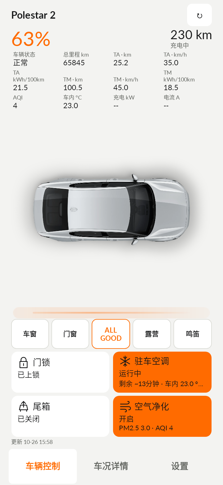
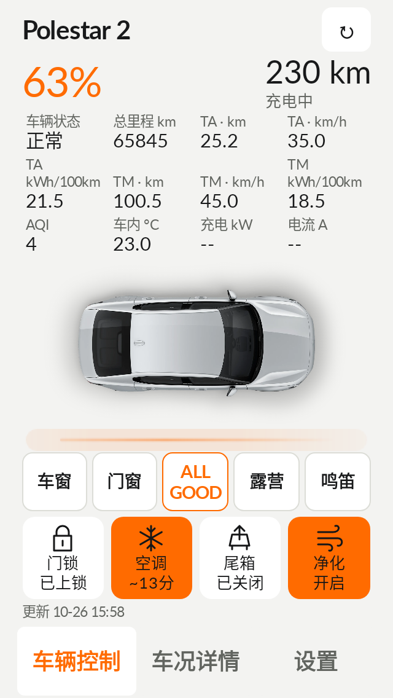
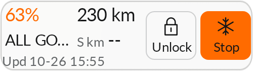

# Psa v0.7.6 beta1 更新说明

版本：`0.7.6-beta1`，versionCode `76`。基线：v0.7.5-beta1，提交 `fa81ac59ed17a5ca9c28f26ac08537a99885ce53`。安卓分支：`android-polestar-assistant-main`。

## v0.7.5 核查

v0.7.5 的 [Actions 40348312346](https://github.com/fifadxy/Polestar-CN-API/actions/runs/40348312346) 已成功，并上传 `PsAssistant-v0.7.5-beta1-debug` APK；已下载核对包内版本 75、ZIP 和 APK 签名。首次失败构建随后通过中文测试语言修正解决。

已完成的改动：车辆身份移到详情菜单，车辆 Health 告警聚合，实验性四轮视图默认隐藏，最多 12 项首页数据，保养数据点击详情使用同一上下文。以下修复基于成功上传的版本继续开发。

## 本版修复

- **一页布局**：合并重复状态区，保留简洁、详细两套风格；按字体实际高度分配主控制卡片和数据行。小屏使用四个紧凑控制卡片；普通竖屏详细风格保留两行卡片，横屏采用分栏。12 项数据、小屏 130% 字号、中英文和日夜模式均纳入验证。能耗单位分两行完整展示，避免将 `kWh/100km` 截成含义不清的单位。
- **反馈统一**：门锁、尾箱、空调、净化均以白色表示已确认关闭/锁定，以 VI 橙色表示已确认开启/解锁。发送中和等待确认单独显示；颜色继续反映最后上报的车况，受理成功不会提前变成车辆执行成功。辅助入口保留细边框、告警 `!` 和露营激活色，三类 Health 都明确正常才显示 ALL GOOD。
- **空调倒计时**：用车辆上报分钟和对应数据时间计算展示剩余量；超过一分钟的本地推算以 `~`/“估算”区分。时间到只提示刷新确认，不把车辆状态自动改成关闭，不发送停止指令。车辆明确报告 0 分钟时不再套用本机 30 分钟回退。只有缺失车辆分钟且本 App 已确认启动时才使用本机回退计时。
- **Widget**：按桌面实际宽高与系统字体比例安排数据；在 2×1 的 118×88dp、4×1 的 250×70dp 下保留更新时间和 48dp 控制触区。文字使用系统缩放的相对字号，主要数值至少 12sp、辅助文字 10sp。透明和模拟磨砂设计保留，新增独立浅色/深色文字选择。空间不足时减少显示字段并显示 `+N`，放大组件可显示更多；不缩成无法阅读的文字。门锁和空调按钮按状态着色，点击后仍进入生物验证。
- **刷新**：Health 改为服务端流式调用，取得第一条消息后取消该订阅，最长等待 4 秒。按车辆缓存 5 分钟，失败短暂退避；失败保留原报告时间与既有数据。用户主动刷新会请求最新 Health。普通车况刷新复用 15 分钟内的车辆列表，减少重复发现请求。
- **数据真实性**：Widget 更新时间取实际显示字段的来源时间，不借用新电池时间掩盖其他数据的时间。Health 的 0/未识别枚举保留未知，避免误判正常。保养为用户配置的本地提醒计算，未接成官方剩余保养接口。
- **效率**：车况变化和前台分钟倒计时更新现有控件，不再重建整个首页；透明度滑块松手后才更新 Widget。多个组件共用一次快照读取，底图有容量上限的缓存。环境光保留独立区域动画，后台、系统禁用动画及省电模式停止，设置中可关闭。夜间车辆轮廓稍微提亮。

## 构建和升级

本版交付为使用保留签名文件构建的 Release APK，`debuggable=false`。包名和黑武士图标保持一致。R8 和资源裁剪继续暂缓，避免未经专项回归影响 gRPC、反射和生物验证。

固定签名证书 SHA-256：`cc87b578976ba45bc06219d66a9cce8a771de457785b2af34be76aeaa3768c94`，与本下载页此前交付的 v0.6.0–v0.6.2 相同。

**v0.7.5 GitHub CI APK 使用另一证书**，SHA-256 为 `a63e45911a113ab5f57f2bab5fa0455343249a84cbe0f36e281228925f3ea400`，不能由本次保留签名直接覆盖。对安装该 CI 包的用户，保留数据覆盖升级需要原签名密钥重编译；不要通过卸载来强行覆盖。其他来源安装包也应先比较证书。

针对已安装 v0.7.5 GitHub Actions APK 的情况，本次另提供 **PsAssistant Preview 并行验证版**，包名 `io.github.polestarcn.companion.preview`。它使用相同功能代码、图标和固定签名，与旧版分别安装，不读取或迁移旧版私有数据；需要在验证版重新导入模板并登录。旧版保留，不自动卸载。后续 Preview 版可沿用相同包名与保留签名覆盖更新。默认 Release 的原包名不变。

仓库不保存私钥或密码。`scripts/build_android_signed.sh` 从 `PSA_SIGNING_KEYSTORE`、`PSA_SIGNING_STORE_PASSWORD`、可选 `PSA_SIGNING_KEY_ALIAS`/`PSA_SIGNING_KEY_PASSWORD` 读取签名设置。GitHub Actions 可通过同名 Secrets 加 `PSA_SIGNING_KEYSTORE_BASE64` 构建同一身份的 Release。未配置这些 Secrets 时，CI 只上传用于验证的 Debug APK，不保证覆盖安装身份。

## 本地验证结果

项目 Debug 83 项测试及额外 6 项渲染检查已通过；Lint 0 错误，Release 编译和 v2 签名检查通过。Preview 变体相同的 83 项项目测试及额外 6 项检查亦通过，Lint 0 错误，APK v2 签名有效。此处数量以本次测试报告为准，CI 状态以对应提交的 Actions 为准。

## 验证和边界

本地项目回归、纯 Java 模型、源码/知识库检查、Android Lint、Release 编译和 APK 签名检查分别记录结果。新增测试核验实际文字高度、可见边界、状态变化后控件复用、流式读取取消和时限、最小 Widget 更新时间、时间来源及未知枚举。

原模板导入、真实账号登录、生物验证、15 秒延迟回读、不重复发送远控、露营阈值和静默通知流程保留。本轮未连接真实账号、车辆或 OPPO Watch X2，接口语义和耗电收益仍需实机验证。四轮 iTPMS 的 China 语义继续保留实验性标记；不宣称已得到真实 kPa。

## APK 校验

- `PsAssistant-v0.7.6-beta1-Preview.apk`：4,335,548 bytes；包名 `io.github.polestarcn.companion.preview`；SHA-256 `13448c782bda506617060517f836483aebbf85217890a857150f3c9c1d19f5f2`。
- `PsAssistant-v0.7.6-beta1.apk`：4,335,328 bytes；包名 `io.github.polestarcn.companion`；SHA-256 `074881072f43bb6c6089dbac12085339b2e4e16526e6d6a8f38eab3bfdf57a5a`。

## 界面示例

以下是原生渲染的合成数据预览，不是实车测试截图。

