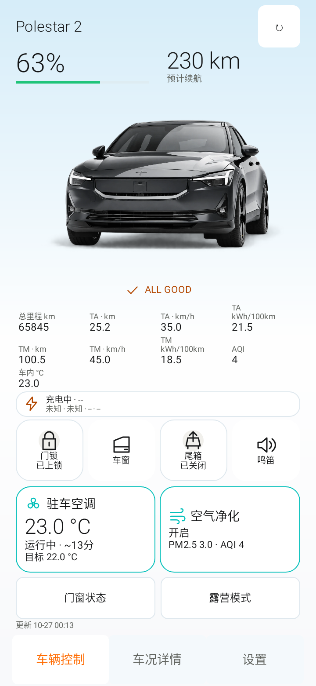
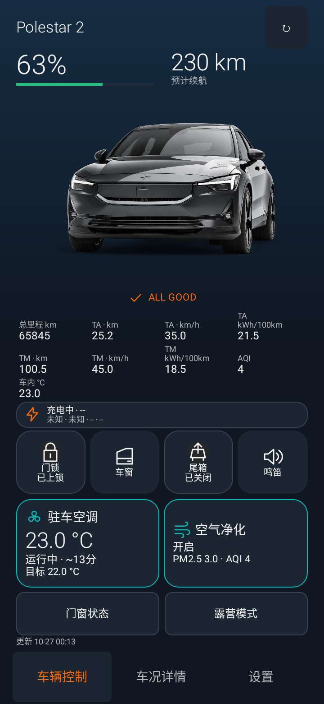
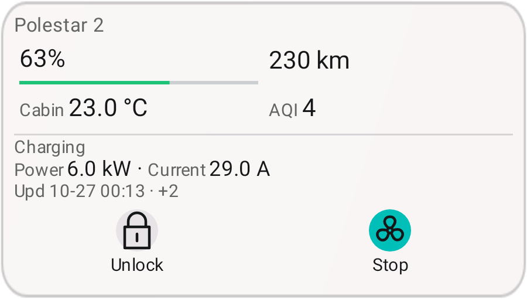

# Psa v0.7.7 beta1 更新说明

版本 `0.7.7-beta1`，versionCode `77`。基线为 `45281847a437127300de20f9c5457b60f20ec190`（v0.7.6），安卓主线 `android-polestar-assistant-main`。

## 界面与功能

- **新增 NIOlike 皮肤**：设置 → 界面皮肤中选择，保留简洁、详细风格；三套均支持浅色、深色和跟随系统。新皮肤参考用户提供的卡片布局，使用极星 2 三分之四视角车辆图、浅蓝背景、薄边框、薄荷绿电量条和青色空调激活提示。常规竖屏提供四个快捷入口及温度/净化卡片，小屏和横屏自动紧凑排列。门锁、尾箱、空调和净化继续直接生物验证；未接入的寻车、召唤、座椅等功能没有添加可执行入口。
- **取消动态光效**：删除光效控件、动画和设置项，按压保留短暂透明度反馈与用户配置的震动，不再缩放回弹。
- **车辆状态放在车图下方**：文字配独立矢量勾选/警示图标。所有启用的 Health 项明确正常才显示橙色 `ALL GOOD`，未知数据不判正常。聚合范围为 12V、玻璃水和可选胎压告警；门窗告警仍有独立入口。
- **胎压可隐藏**：设置中关闭“显示胎压状态”后，首页、详情与 Widget 不显示胎压，并从可见 Health 汇总排除；仅改变显示，不删除数据或已选字段。四轮 iTPMS 仍是默认关闭的实验性详情，不宣称得到真实 kPa。
- **电量与续航统一**：电量百分比下方为横向电量条，预计续航在旁边；主控制页、详情和带电量字段的 Widget 使用同一结构。
- **充电独立栏**：仅新鲜的开始充电/充电中/智能充电报告显示。已连接充电枪、残留功率/电流或正在供电本身不能视作充电；计划、暂停、完成、放电、故障状态隐藏。未知/空闲时，仅“已连接且供电初始化中”的握手可显示启动栏。过期超过 15 分钟、未来时间和演示数据均不显示充电栏。首页独立栏点击可查看六项完整数据，详情另设完整充电分组；字段选择保留。
- **详情分组**：电池与续航、里程与行程、充电、门窗与车况、空调与空气、保养。数据未知继续显示 `--`。
- **Widget**：保留五种尺寸、门锁/空调按钮、独立中英文、透明度与模拟磨砂设置。NIOlike 对应浅玫瑰/深蓝灰底色、圆形控制图标和薄荷绿电量条；充电字段移到独立栏。按尺寸与系统字号分配空间，显示不下的已选项以 `+N` 提示，展开组件可显示更多。更新时间继续取实际显示字段的数据来源时间。

## VI 与资源

依据 [Psa VI v5](Psa_VI_UI_Design_Specification_EN_v5_Optimized.md)统一基础色、静态图标和细描边勾选样式。Psa 两套基础皮肤使用 0–8dp 圆角；NIOlike 按用户最新参考采用较大圆角。浅色小字号橙色文本使用较深的 `#B34700` 保持可读性，深色文字强调与基础激活填充使用 `#FF6B00`。原品牌字体未提供，改用规范允许的 Android 系统 sans-serif / sans-serif-light，不再打包 Lato。

极星 2 新图由官方页面车辆素材衍生，移除摄影背景并编码为带透明度的 WebP；来源与处理见 [车辆素材记录](../branding/android/vehicle-hero.md)。黑武士桌面图标保持用户指定版本。没有新增连续动画、后台定时器或车辆轮询；前台分钟刷新复用现有机制。

## 构建与安装

- Debug 和 Preview 各 **102 项项目测试通过**，含三套皮肤、中英文、日夜、小屏 320×568 / 横屏 640×320、130% 字号、12 项字段、按钮实际可见区域、充电状态转换及原生 RemoteViews 检查。最小 Widget 保留 48dp 控制触区。
- Debug/Preview Lint 无错误；纯 Java 模型、源码结构与知识库检查通过。Release/Preview 均编译通过且 `debuggable=false`，APK v2 签名有效。
- 本地 APK 沿用保留证书 `cc87b578976ba45bc06219d66a9cce8a771de457785b2af34be76aeaa3768c94`。Preview 包名 `io.github.polestarcn.companion.preview`，可覆盖同证书的 v0.7.6 Preview。已装 v0.7.5 Actions 原包名版的用户请安装 Preview，保留原应用和数据；需要在 Preview 单独导入模板并登录。原包名 APK 仅适合签名兼容或全新安装。
- CI 未配置保留签名 Secrets 时只交付 Debug 验证构建，不能保证签名覆盖兼容。密钥不在仓库中。

登录、真实账号、车辆、生物硬件、OPPO Watch X2 和耗电仍需实机验收；本版没有改变协议、远控写入规则、约 15 秒延迟回读、Token 按需刷新或露营阈值。

## 界面预览

以下为原生界面使用合成测试数据渲染，不是实车截图。

## APK 校验

- Preview：3,823,157 bytes（约 3.65 MiB），SHA-256 `5faee016dfd3338c1264e21bd2ccf235faa87c9a8d4f6210d7b23a5ff2a97f2c`。
- 原包名版：3,823,061 bytes，SHA-256 `39ca570ad8c394a50a00215fa61825c519eebec7396e83ee1703c7355e89d0d1`。
- 相比 v0.7.6 的同签名构建，APK 缩小约 12%；此为文件体积比较，不是运行耗电测量。
