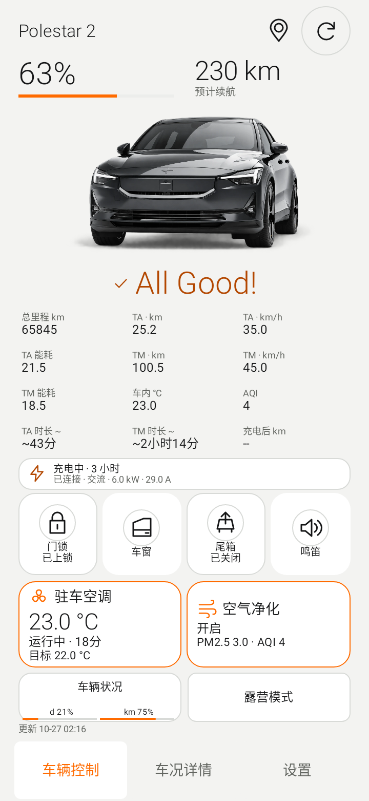
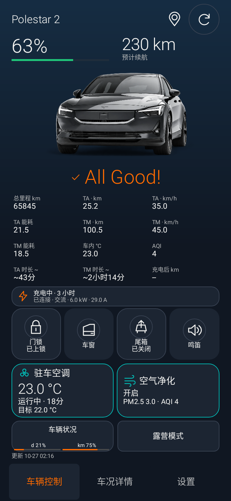
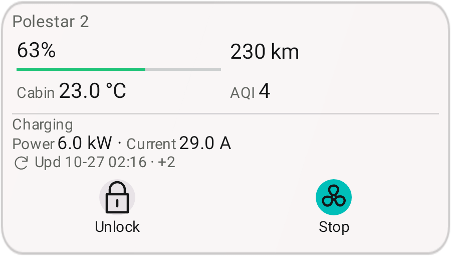

# Psa v0.7.8 beta1 更新说明

版本 `0.7.8-beta1`，versionCode `78`；基线 `e28f857943679b6f81c1c82bc2fdc892e091506e`（v0.7.7）。安卓主线 `android-polestar-assistant-main`。

## 界面与操作

- NIOlike 空调与净化卡片缩小，门锁、车窗、尾箱和鸣笛入口增加圆形描边；数据单行对齐，小屏/横屏自动紧凑排列，首页不需要滑动。鸣笛等未获协议支持的操作仍不发送写请求。
- 新增 **NIOlike2**：与 NIOlike 共用布局，采用 Psa VI 灰白/炭黑/橙色日夜配色。设置 → 界面皮肤可切换四套风格；原 NIOlike 保留蓝色/薄荷绿/青色。
- 车况合并门窗、尾门、12V、雨刮液、胎压、保养及其他健康项。至少收到一项车况且没有已知问题时，车图下方显示与电量百分比同字号的 **All Good!**。部分项目未上报时不阻止此汇总，详情仍明确显示未提供；全部未知不显示正常。
- 每个车况/行程分组保留约 5 项主要数据，其余通过二级菜单展开。刷新改为融入各皮肤的图标入口。
- 所有界面复用可调震动设置；各皮肤字体独立保存 80%–120%，Widget 字体单独调整，并叠加系统字号。紧凑区域适配边界，完整值可点击查看。最小 Widget 仍保留 48dp 控制触区、更新时间与透明/磨砂设计。
- 黑武士桌面图标不变。生物识别、约 15 秒首次回读、按需 Token 刷新及露营默认 31 分钟/10% 规则保留。

## 车辆健康与保养

交叉核对用户新上传、已确认中国区可用的参考 APK `0.1.20261027.081805`。健康读取改为 China C3 的 `HealthService/GetLatestHealth` unary；仅遇到 UNIMPLEMENTED 时回退 `GetHealth` streaming，首条响应后取消，两者均有短截止时间。

补充保养状态、制动液、冷却液、机油、雨刮液、12V、电灯告警。机油字段由 Mac/上游映射支持，最新参考实现没有打印它；BEV 未上报时显示未知，不补造“正常”。胎压数值仍未经 China 实车验证，实验开关不变。

示例 **931 小时 · 75 天 · 14959 km 均为剩余保养值**，优先显示车辆报告；缺失时才使用已配置的本地保养记录。设置可分别打开车辆状况按钮中的时间/里程百分比及进度条，所有皮肤共用。百分比为“剩余量 ÷ 用户配置周期”的估算（默认 365 天/20000 km），不是车辆提供的寿命百分比。Widget 选择车况字段且空间充足时显示同一进度条，窄组件可直接选择百分比字段。

## 停车位置二级预览

四套皮肤页眉增加位置图标，点按才通过发现结果中的独立 `c3Lbs.grpcHost` 调用 `dtlinternet.DtlInternetService/GetLastParkedLocation`。弹窗显示车辆上报时间和可能过期提示；这是最后停车位置，不是实时定位。

**设置 → 高德小地图预览（可选）**：开启开关并填写自己的高德 **Web 服务 Key**。Key 仅在本机加密保存，默认不开启；打开位置弹窗后加载 640×360 静态地图，点击地图或“打开高德地图”进入地图应用。无高德时尝试系统地图，无 Key 时仍可跳转。失败时保留跳转入口，关闭弹窗取消请求。

预览会把该次停车经纬度与自己的 Key 发送给高德，并使用相应额度；没有新增手机定位权限、地图 SDK 或后台定位。停车坐标仅驻留内存，不进入日志/车况缓存。官方静态图 API 见 [高德说明](https://lbs.amap.com/api/webservice/guide/api/staticmaps)。需要允许该服务的 Key；启用数字签名校验的 Key 还需签名适配，当前直连模式未提供。沿用参考程序中国区坐标路径，未推断额外坐标转换，实车位置对齐仍需验收。

## TA、TM 与补充行程字段

- 保留 TA/TM 距离和平均速度；加入行驶时间估算（标 `~`）、充电后距离/平均速度/平均能耗，供首页和 Widget 选择。
- 发现旧公开 schema 将 Battery field 12 定义为 TA 平均能耗，但当前上游 Hisingen 2.0.10 把它识别为电池容量。**单独收到 field 12 不再当成 TA 能耗。**
- 只有同次 Battery 的独立 TA 能量字段 15、时间对齐的 TA 距离能相互印证时才采纳；没有直接值但独立能量与距离有效时可计算并标 `~`，冲突/缺失显示 `--`。旧缓存中的未验证 TA 能耗失效，保留已有里程。真实 China 车辆若不提供足够字段，本版也不能制造读数。
- TA/TM 行驶时间按距离/平均速度估算，非车辆原始时长；不增加车辆查询和复位请求。依据与映射见 [v0.7.8 知识库](../knowledge/25_V078_CONDITION_LOCATION_TRIP.md)。

## 验证与安装

Debug/Preview 各 123 项项目测试通过，四套皮肤 × 中英文 × 日夜；320×568、640×320、360×780，最高合成字体倍率 1.56；12 项自选数据、充电栏、保养进度条和原生 RemoteViews 的边界/48dp 触区检查。Lint 无错误，纯 Java 模型、源码与知识库检查通过。Release/Preview 编译通过，调试标记关闭，APK v2 签名有效。

保留证书 SHA-256 `cc87b578976ba45bc06219d66a9cce8a771de457785b2af34be76aeaa3768c94`。Preview 包名 `io.github.polestarcn.companion.preview`，可覆盖同证书 v0.7.7 Preview；原 Actions v0.7.5 签名不保证兼容，请用 Preview 并保留旧应用。原包名包仅用于签名兼容或全新安装。CI 无保留签名 Secrets 时交付 Debug 验证包。

以上使用合成协议与原生渲染测试；真实车辆/高德 Key 在线加载/生物硬件/OPPO Watch X2/耗电尚需实机验证，不能据此标记 PROJECT_DEVICE_VERIFIED。

## 界面预览

以下为合成数据的原生界面渲染。

## APK 校验

- Preview：3,840,442 bytes，SHA-256 `5ccf7c0590b4c7b6062505a007cfa6a5710ae86b5b435450a7a7e7a32b597a22`。
- 原包名版：3,840,270 bytes，SHA-256 `59bfc9c2a9f1b97351e09f6396ff30514cd4a0a17f66553c098a09b02da9ad34`。
- 未加入地图 SDK，较 v0.7.7 增加约 17 KB；不代表已实测耗电改善。
