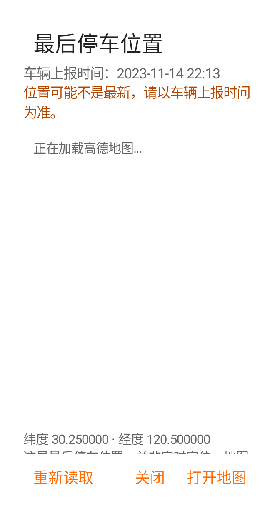
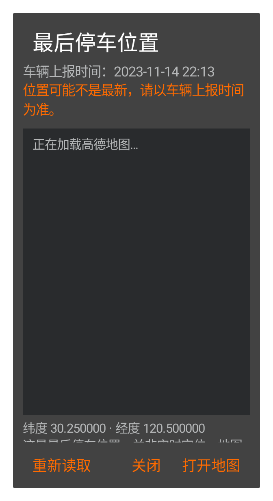
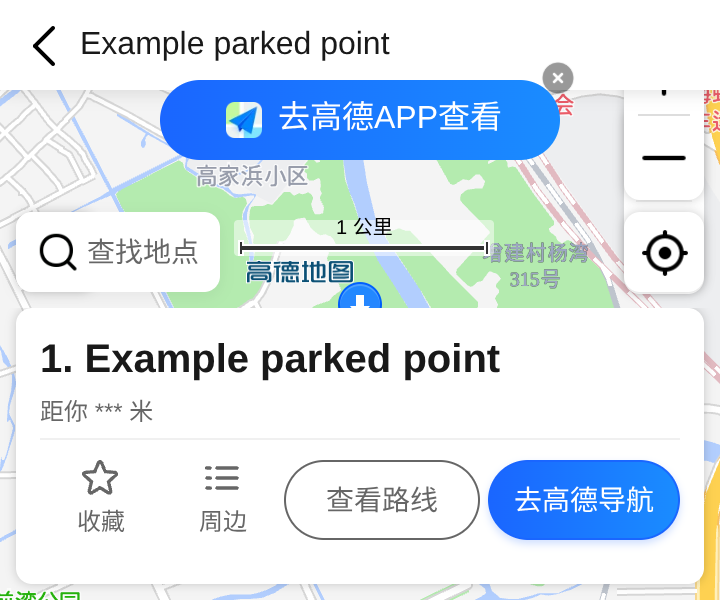

# Psa v0.7.9 beta1 更新说明

版本 `0.7.9-beta1` / `79`，基于 v0.7.8 `031ef0b65d264f7258a3ac674da051507b6335d7`。

## 无需高德 Key 的停车位置预览

首页右上角位置图标 → 读取 China c3Lbs 最后停车位置 → **二级弹窗内嵌高德官方地图网页**。不需要注册开发者、填写 Key 或登录高德账号；显示车辆上报时间、位置可能不最新的提示与经纬度。四套皮肤均可使用。地图由高德网页提供，其网页颜色、字体和功能随服务变化；原生弹窗沿用 Psa VI 日夜样式。

“打开地图”依次尝试高德 App、官方 HTTPS 地图网页、Android 系统地图；都不可用时给出提示。“重新读取”重新获取车辆报告。WebView 不可用、断网、HTTP 错误或加载超时均保留外部入口。

移除上一版静态图片接口、Key 输入与存储代码，升级时清除旧地图 Key 配置。使用系统 WebView，不新增地图 SDK、native 地图库、手机 GPS 权限、后台地图轮询或停车轨迹。

## 对另一份 AI 文本的核对

- 附件仍要求 Static Map Key，不能据此推断静态图接口免 Key。高德官方静态图片接口把 Key 标为必填；本版改用免 Key 的官方 URI 位置网页，**不是去掉 staticmap 请求的 Key**。
- 附件称位置 payload field1=纬度、field2=经度，与参考 APK 实际赋值不符。复核 DEX 对应方法后继续保留 **1=经度，2=纬度**；响应 payload2 内 field3 是时间戳，外层 field3 是位置可能过期标记。
- 附件“不要 WebView”是原建议，用户随后明确选择 App 内网页预览，因此本版使用受限 WebView。没有复制附件指令、生成生产 Key 或获取高德个人账号。
- 继续沿用参考 China 路径的 dev=0 / coordinate=gaode，不擅自转换坐标。`China C3 LBS coordinate system requires real-car verification`，实际停车点对齐仍需实车验收。

来源：[官方单点标注 URI](https://lbs.amap.com/api/uri-api/guide/mobile-web/point)、[官方静态地图 Key 要求](https://lbs.amap.com/api/webservice/guide/api/staticmaps)。

## 稳定性与隐私

c3Lbs 使用独立发现主机，已保存的主机同样检查可信 `.volvocars.com.cn` 域名；LBS RPC 独立 4 秒截止。拒绝 NaN、越界和无效原点 0,0。读取失败只提示停车位置不可用，不清空登录或已有车况；诊断只记通用失败事件，不记录坐标、完整地址或 VIN。切车/退出时使旧请求失效。

打开弹窗会将该次停车点交给高德网页；页面不接收 VIN 或车辆会话。限制顶层导航到高德 HTTPS 域名，关闭文件/content 访问、混合内容、网页定位和权限请求，没有 JavaScript 到原生桥。页面需要 JavaScript；不接受 Cookie，不保存表单与 WebView 状态、不使用磁盘页面缓存。关闭弹窗、切车、退出或 App 进入后台时销毁 WebView并清理本应用网页存储。不建立持久停车坐标缓存或历史轨迹。

网页加载和耗电只在打开预览期间发生，相比静态图片会有更多网页资源开销，不能宣称和静态图等耗电。服务可用性和网页布局由高德决定；本版提供退出及外部地图兜底。

## 验证与安装

新增 Key-free URI、App/Web/geo 兜底、旧 Key 清理、受限 WebView、定位权限拒绝、关闭释放、四皮肤中英日夜小屏/横屏弹窗，以及 c3Lbs 请求/4秒截止、可信主机、失败隔离、切车/退出丢弃结果测试。Debug/Preview 各 140 项测试通过，Lint 无错误，纯 Java 模型、源码和知识库检查通过；Release/Preview 均编译成功、调试标记关闭且 v2 签名有效。

本地 APK 沿用 v0.7.8 的保留证书，Preview 可覆盖同证书旧 Preview。原 Actions v0.7.5 原包名安装继续建议并行使用 Preview，避免签名冲突与数据丢失。CI 无保留签名 Secrets 时上传的 Debug 包不能保证覆盖兼容。

已用官方文档公开示例点验证免 Key URL 返回高德移动网页，并在云端浏览器显示实际地图底图；不代表实车位置或 Android WebView 实机渲染已验收。真实账号、坐标偏移、手机系统 WebView 与地图 App 组合仍需用户设备验证。

## APK 校验

- Preview：3,841,098 bytes，SHA-256 `76f13dec4819548974d094eb33165377162e57637493f0cd86afe5ecc37f3856`。
- 原包名：3,841,062 bytes，SHA-256 `3a08250fcbb8e1990ae217d80eda20d6a76a4e3d4733954e100cb75eca5ab21a`。
- 两包证书 SHA-256 `cc87b578976ba45bc06219d66a9cce8a771de457785b2af34be76aeaa3768c94`。未新增 APK native 库或依赖；WebView 运行资源由手机系统提供，文件体积不代表网页运行占用。

## 位置界面预览

前两张为合成数据的原生弹窗容器，Robolectric 不渲染在线 WebView，所以显示加载占位；第三张为云端浏览器中的高德官方公开示例点，证明该网页路径可免 Key 显示地图，并非本项目 Android 实机或用户实车截图。保留高德网页原有署名和样式。

