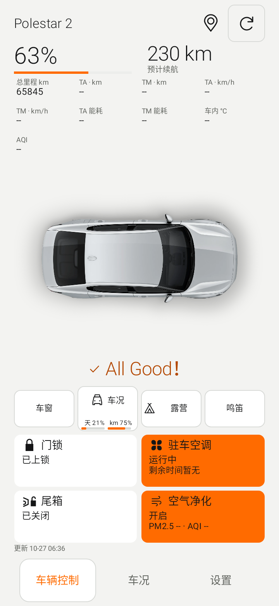
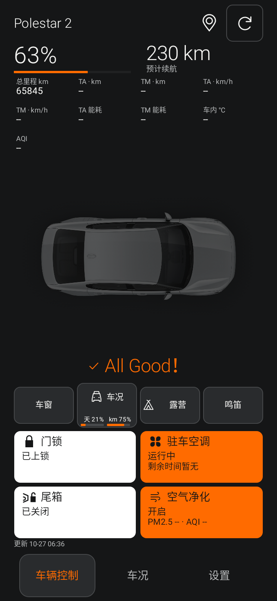
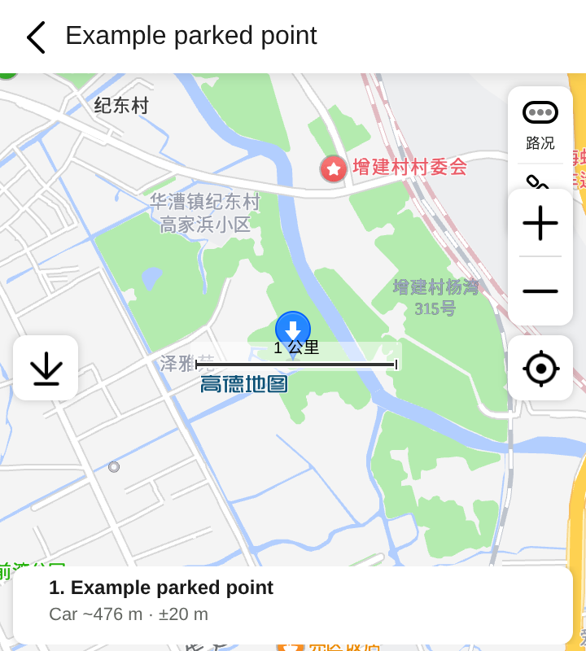

# Psa v0.8.3 beta1 更新说明

版本 `0.8.3-beta1` / versionCode `84`。基于用户指定的最新 v0.8.2-beta1 / 83，提交 `97447593e2f59cd683d908e2049cfba71025ce06`，保留该版本的 VoLike 竖屏、横屏与其他既有功能；已停止旧版本迭代。

## 主程序

- 恢复独立 **PS默认皮肤**，沿用原详细模式的黑白灰/橙色、顶视车辆和控制布局，并纳入当前一页自适应骨架。VoLike 简洁、详细、极星配色及 NIOlike、NIOlike2 仍保留，共六套皮肤；设置里的预览同步。
- 车况正常时，车辆下方统一显示 **All Good！＋矢量勾**，不随中英文改变。仍按已报告项目汇总；异常有警示，全部未报告不会冒充正常。
- 车况按钮改为图标/标题独立行，保养比例与进度条在下方独立区域，防止标题被挤掉或重叠；露营增加同族图标，激活颜色和原震动设置保留。
- 空调和净化共享相同大小的图标槽、标题与反馈基线；NIOlike 温度/AQI 主数据行对齐。能耗标题统一单行，完整单位点按查看。未知空调时长明确显示未上报，避免“剩余运行中”。

## 自动读取保养

剩余保养公里、天数和工时只取车辆最新 Health 报告。删除主程序的手动日期/里程输入与本地记录替代显示逻辑；旧本地记录不再参与计算，车辆未上报时显示 `--`，不会用本地历史填补。读数仍沿用已核实的 GetLatestHealth外层field3的payload中field2/3/4分别为剩余工时/天/km，不新增 RPC。

百分比不是车辆直接返回的数据。仍显示按 **365天/20,000km参考周期**计算的剩余比例，明确在详情说明；旧用户手动周期不再改变它。主页、车况详情和 Widget 共用 ServiceReading，更新时间来自 Health 报告，不用当前时间伪装刚更新。

## 地图与可选手机定位

六套皮肤和 Widget 位置入口共用 VoLike 简洁同一条读取/显示链路：独立 c3Lbs → 最后停车位置 → 二级弹窗内嵌免 Key 的高德官方位置网页。不新增地图 SDK、Key 或逆地理编码，也不伪造街道地址。

压缩高德分享网页中影响预览的覆盖层：隐藏巨大的 App 跳转浮层，移除底部冗余网页操作，将地点/距离卡由示例中的约146px压至48px，距离文字16px行高。保留地图本体、标记、高德署名与地图控件；真正“打开地图”使用原生按钮，原 App/Web/geo 兜底不变。适配样式只在可信高德 HTTPS 页面加载，网页结构变化时可能需要更新。

新增 **设置 → 停车地图 · 手机定位权限**（预览内也有入口），默认关闭。用户开启时才请求 Android 前台近似/精确位置权限；只有已开启、系统授权且来源为可信高德 HTTPS origin 时才允许网页定位。开启后可点地图定位按钮，让网页判断离车距离；近似位置准确度较低，分享网页若未自动更新距离，以一次性浏览器定位在网页内补充距车直线估算及定位精度；手机WGS84点在中国范围内转换一次，车辆报告点不转换，坐标假设仍待实车核对。地理距离不等于步行路线。不申请后台定位权限，关闭/后台切换销毁 WebView，不保存手机位置历史。拒绝权限仍可查看车辆停车点。

已用官方公开示例点在云端浏览器核对压缩后的覆盖层、署名及合成手机点的距车估算（约476m、±20m，车辆点未转换）。实车位置偏移、手机 GPS 与高德网页的端到端距离仍需手机验收。此位置始终称“最后停车位置”，不是实时追踪。

## Widget 自适应与 PSeu

修复 VoLike 旧实现以固定420×220画布绘制所有文字、再非等比拉伸的根源：**经典、VoLike和PSeu全部使用原生文字/按钮布局**，位图只用于背景/车辆，车辆始终等比显示。字号、字体粗细、数据数量与可用宽高共同决定布局，空间不足缩减本次可见数据并显示 +N，保留选择；更新时间和48dp控制区优先。

- 支持2×1、4×1、2×2、4×2、Data4×4五类组件，拉伸、窄矮横屏会切换实际布局。Android12+优先使用主机上报的精确SizeF布局，支持最多四个主机尺寸；旧桌面使用横竖屏范围兜底。尺寸变化直接使用回调参数，背景按实际形状生成。
- 新增独立 **PSeu** 风格，参考用户截图的黑白/炭灰、星形标记、橙色电量条和并排控制。可选电量优先、续航优先、车辆图、扩展控制；选择“Widget数据”后可按尺寸独立设置PSeu数据，和经典/VoLike选择分开保存。
- 扩展控制在足够宽的组件显示锁车、解锁、空调开启/关闭；窄小组件保留门锁和空调基础控制。指令仍进入生物验证，取消不发送，不改变延迟回读或自动重发规则。
- 增加 **Widget加粗字体（所有风格）** 开关，默认关闭；所有文本与预览共享，字宽测量同步考虑粗体。Widget字号保持独立80%–120%设置并叠加系统字号，布局自动适配。
- 保留不透明/透明度、模拟磨砂、独立语言与日夜设置。布局类型/粗体/字号为Widget全局设置，数据按尺寸保存，同尺寸实例共用数据设置；不声称为每个实例的独立配置。

依据：[Android官方自适应/精确Widget布局](https://developer.android.com/develop/ui/views/appwidgets/layouts)。文件大小不代表实际桌面耗电，本版未新增车辆/地图轮询。

## 公用图标规范

新增 [Psa按钮图标设计规范v1](Psa_Button_Icon_Design_Specification_v1.md)和SVG图册，作为本次及后续按钮参考。资源统一覆盖空调启停、锁车/解锁、尾箱、车窗、净化、车况、露营与勾选。采用用户提供控制中心图的四叶实心风扇、实心锁体和同族轮廓；这是独立实现，不能称为官方原始矢量母版。App/Widget复用同一drawable，黑武士桌面图标不变。

## 验证与安装

验证覆盖六皮肤/中英/日夜/320×568与640×320及1.56倍率、五种Widget/多长宽比/系统字号与80%–120%用户字号/加粗、原生图标与车况按钮、自动保养、定位默认拒绝/授权/撤销、c3Lbs及远控生物验证回归。Android15另验证现代精确尺寸和旧主机范围兜底。Debug与Preview各166项Android测试及独立JS距离测试通过，0失败/0跳过；两种Lint无错误，Release/Preview编译及v2签名验证通过。

Release/Preview沿用保留证书 `cc87b578976ba45bc06219d66a9cce8a771de457785b2af34be76aeaa3768c94`。同证书旧Preview可覆盖升级；GitHub Actions来源旧原包名Debug签名可能不同，建议并行安装Preview以保留原应用及数据。没有引入native地图库，仍支持Android8+。

尚未完成用户实车、全部OEM桌面、实际GPS距离、OPPO Watch X2及耗电验收。构建/合成测试通过不能标为PROJECT_DEVICE_VERIFIED。

## 预览

以下为合成数据的原生界面；地图图为官方公开示例点和合成手机定位在浏览器中的页面，不是用户车辆或Android实机截图。

## APK 校验

- Preview：3,874,968 bytes，SHA-256 `7d41a0bf42c5db6d2a17b56cad004a65429012af4fc4b983aa2b125d5e03533b`。
- 原包名版：3,874,840 bytes，SHA-256 `b91b98aaf3e50cf5ce91c4a697b56a4e50afa192affe1a14e85e2d596d5b830e`。
