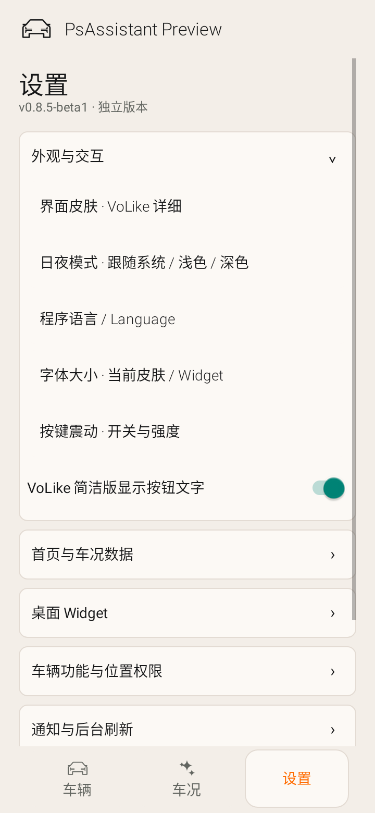
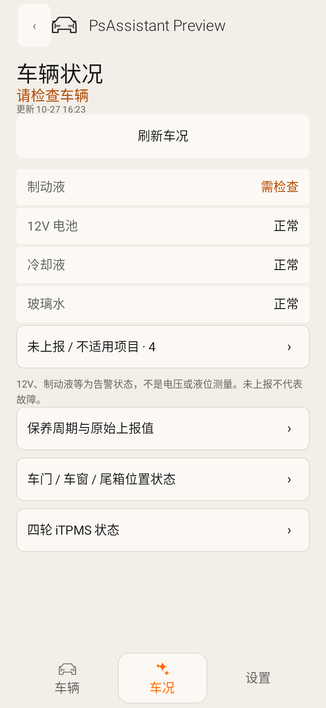
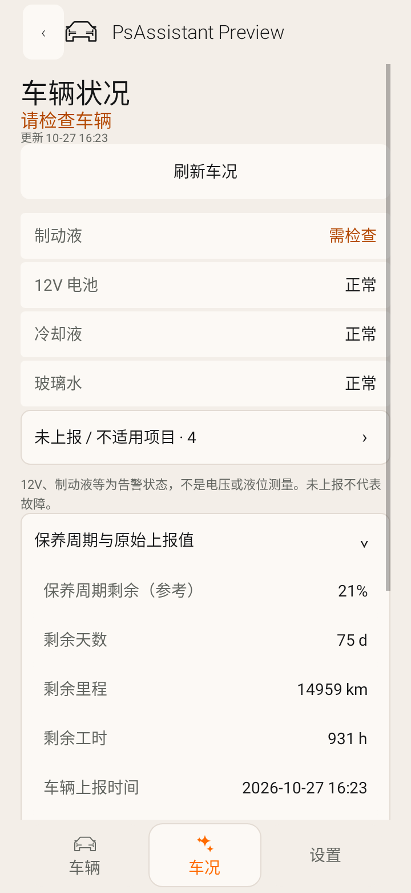

# Psa v0.8.5 beta1 更新说明

版本0.8.5-beta1 / versionCode86。核查时最新远端是v0.8.4-beta1 / 85 / 6544d6ce3ec6f6e9af6b826b6175ac8e761f0b06。本轮在此基础上修改，不回退图标、30000km保养、充电上限、协议或四时点回读。

## 车况入口与展开式详情

六套手机皮肤的车况按钮、车辆下方汇总、车辆图入口共用同一页内车况目的地；Widget已选车况字段也能直达。没有快照时仍能进入并显示刷新入口；已登录但车辆发现暂时失败时可以重试，不因selected为空而把入口变成无响应按钮。独立车况页有固定返回入口，返回原首页/数据/设置页。

车况二级内容改成原页面的箭头展开/收起，不再层层弹窗：保养原始读数、四门/四窗/尾箱位置、四轮iTPMS都在页内。车辆数据页的行程、充电、空气、保养、车辆信息也采用相同模式。选择语言、编辑设置、生物验证、免责声明等输入/确认弹窗保留。

车辆检查排序：异常先显示，其次已上报正常状态，保持12V、制动液、冷却液、玻璃水等稳定顺序。主区最多5项，多余已报告项目与未报告/不适用项目分别折叠。部分轮胎报告显示“部分已上报”，不会冒充全轮正常。未报告不是故障；12V/制动液等是告警状态，不虚构电压或液位数值。未验证kPa仍不显示，四轮示意图偏好继续有效。

展开状态按分区保存；刷新、改语言/主题及重建时保留，滚动位置尽量恢复。子内容首次展开时才构建，重复折叠不重建；读数返回时更新同一信息层级。等待指令回读的每秒进度只更新文字，不重建设置或折叠车况区。

## 设置重新分组

按以下顺序排列，均可展开收起，原偏好键与用户值不改：

1. 外观与交互：皮肤、日夜、语言、字号、震动、VoLike文字。
2. 首页与车况：自选数据、车辆图/充电/更新时间、胎压和示意图、车况/保养入口。
3. Widget：风格、按尺寸的数据、PSeu类型、字号、加粗、语言、背景/文字色、透明/模拟磨砂。
4. 车辆功能与位置权限：露营、可选手机定位。
5. 通知与后台刷新：静默常驻通知、系统电池设置。
6. 手表预览：圆屏/方屏与两种风格，仍明确不是独立Wear OS交付。
7. 账户、诊断与关于：独立构建状态、协议、诊断日志、退出、版本。

设置操作左对齐。页面刷新不每秒重建设置，展开子视图也沿用用户震动选项。退出/切车在车辆事务确认期间明确暂缓，防止操作状态覆盖。

## 独立安装与登录

删除模板安装检测、包可见性查询、APK选择器、导入线程与界面导入入口。`ClientSignatureProvider`从完整安装包自身读取构建时提供的客户端配置；手机无需安装、保留或导入另一个APK。手机号/密码登录签名算法及服务接口不变，账号会话继续加密保存，控制仍需生物验证；不是演示或匿名车辆数据。

本次交付的签名Release/Preview已在私有构建环境配置，验证其资产存在、与输入匹配、没有夹带其他APK。旧版已保存的兼容配置仍可作为升级兜底，不要求再导入。模板来源签名证书与已验证家族一致。未用用户真实账号发起登录或实车控制，登录服务/车辆权限仍需用户设备验收。

客户端配置不写入公开仓库或公开源码。见[独立构建说明](Psa_Standalone_Build.md)。公开CI未配置`PSA_CLIENT_CONFIG`时只生成明确标识的开发验证APK，不宣称可直接登录；本页私有交付的完整签名包不受此限制。完整Release/Preview构建缺少私有配置会失败，不默默交付缺配置的分发包。配置随客户端打包不代表它是无法提取的服务端秘密，用户账号密码/token和APK签名私钥仍分别管理。

## 验证与交付

Debug/Preview各186项完整回归通过，0失败/0跳过；Lint无错误。签名交付，包含六皮肤入口/空快照、缺失车辆重试、异常/已报告排序、部分轮胎、页内展开与返回、设置分组/Widget偏好保留、配置读取无其他App依赖、旧版本车控/字体/Widget矩阵。还单独运行无私有配置的CI路径，确保源码可验证且缺配置时清晰失败。

以下图片是合成数据的Android原生测试渲染，不是实车或实机截图。

本版沿用固定签名。同证书旧Preview可覆盖升级；旧GitHub Actions原包名签名不兼容时，使用独立包名Preview并行安装保留原数据。实车登录、充电上限权限、GPS、全部OEM桌面/手表/耗电仍待设备验收。

## APK校验

- preview: 3739726 bytes，SHA-256 `9af7d00671cbd78008830c30acab58d9c724313e21c14a6e4f849cea0e62285a`。
- release: 3739606 bytes，SHA-256 `5f655162341cd831cba220d8287c72d4527b22a681fbab4116aff974d3926dcf`。
