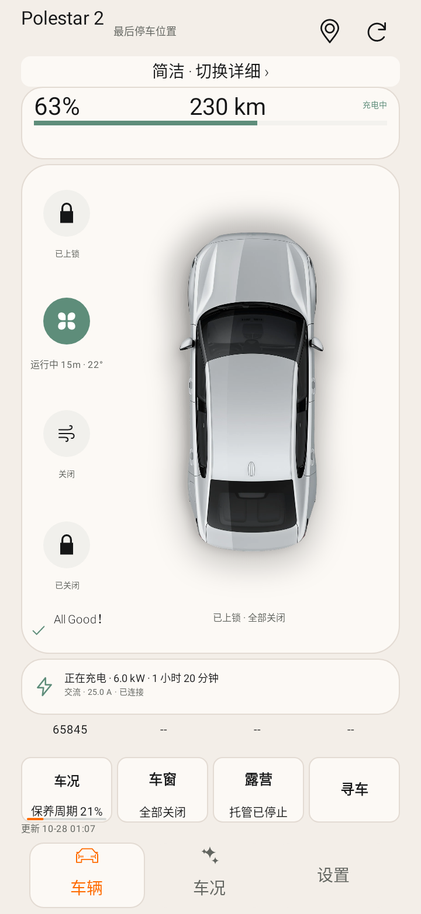
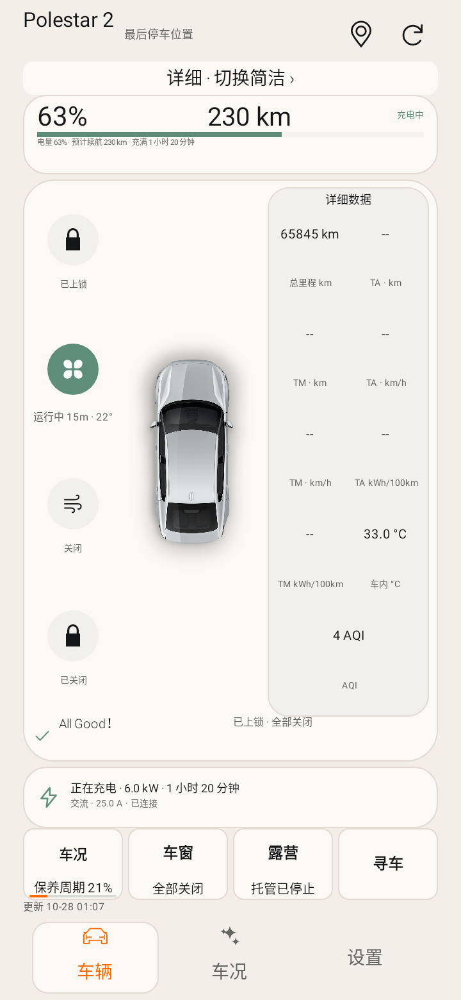
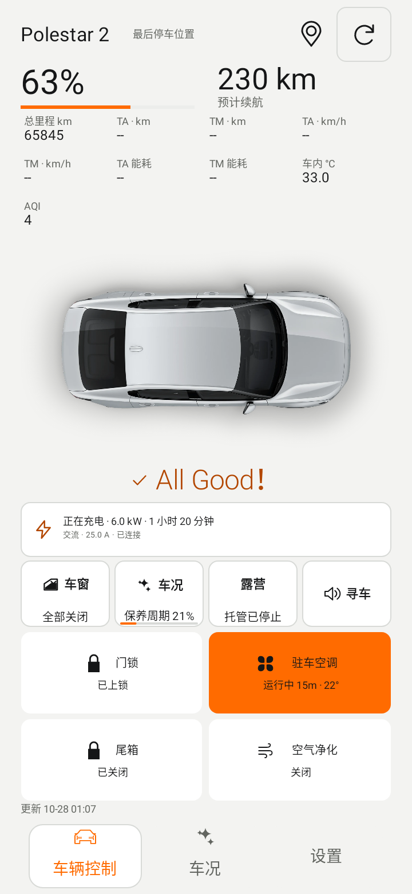
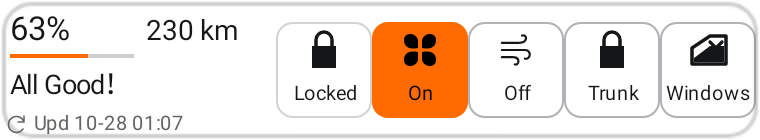
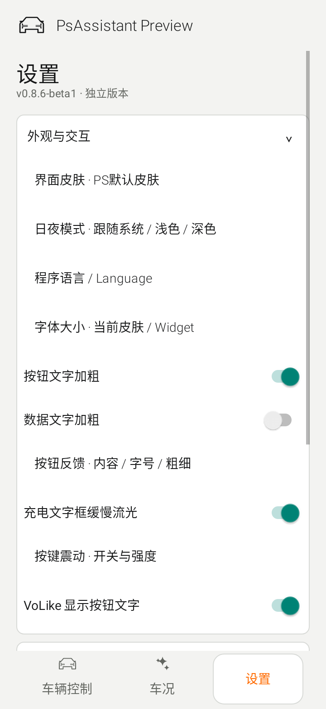

# PsAssistant v0.8.6-beta1

2026-10-28（香港时间）。versionCode **87**，基于核对后的 v0.8.5-beta1 / 86，父提交 `5d099a8913e5ef1ff75b3bcb0abc41f5713d3cbe`。

## 本次实现

| 范围 | 行为 |
| --- | --- |
| 所有手机皮肤的车况按钮 | 文字、百分比与参考周期进度条统一居中；设置可选文字＋百分比＋条、仅文字＋百分比、仅文字。车况与露营保持同尺寸。异常和已上报的12V、液体等项目仍优先，详情页内展开。 |
| 控制反馈 | 图标和标题组居中，下方反馈有独立内容、字号8–14sp、粗体和总开关；按边界缩字、必要时省略，完整内容保留无障碍描述。按钮名称和数据值另有独立粗体开关。 |
| 空调 | 默认保留运行状态、剩余时间、设定温度，隐藏按钮中的车内温度；可主动选择车内温度或隐藏反馈。时间使用h/m，不加约或~。倒计时/行驶时长来源仍在详情解释，未改成实测。 |
| VoLike | 简洁、详细在一个可选皮肤中，通过切换按钮或右滑切换；详细数据位于右侧框。旧 detailed 配置仍可升级读取。另保留VoLike Psa配色、NIOlike、NIOlike2、PS默认。短横屏按排序优先展示最多6个扩展数据，选择不被删除，全部可在数据页查看。 |
| 定位文字 | 固定68dp改为弹性宽度，坐标显示精度增加；单行省略，点按看完整停车点。没有伪造街道地址或添加逆地理编码Key。 |
| 主页排序 | 设置中有真实拖动手柄≡，并提供上/下移无障碍操作；保存后按选择顺序展示。电量/续航固定能源区不参与扩展数据网格重排。 |
| 默认皮肤图标 | 窗、寻车用既有Psa规范图标，车况复用底部车况导航图标；新增图标不改变露营的无图标约定。 |
| 门窗详情 | 车辆四角文字按各自框宽缩字并裁切保护；保留车辆图、连接线和完整无障碍状态。 |
| 充电 | 充电信息框使用从左到右4.8秒循环的柔和底层光效；只在充电区显示、可见且系统允许动画时运行，暂停/离开页面停止，可关闭。无新增地图或动画SDK。 |
| 健康数据选择 | 12V电池、制动液、冷却液、玻璃水、适用时的机油状态可选入主页和Widget；为现有Health API的告警状态，不是电压/液位测量。缺失显示--。 |
| Widget状态 | 所有风格共用状态绑定；锁定/解锁图形区分，开启状态颜色来自快照，不在发指令时乐观改成成功。固定上锁/解锁/空调启停仍可选，远控进入原生生物验证。 |
| Widget选择 | 各尺寸独立选择显示数据及最多6个按钮，按选择顺序，在实际宽度内优先保留可用触控区域；窄尺寸只显示能容纳的前几个。新增5×1，可显示5个控制按钮；较宽尺寸可显示6个。 |
| Widget选择器 | 全部receiver和预览图使用App启动图标。旧尺寸、透明/不透明、PSeu、粗体、字号和更新时间保留。 |
| App/Widget刷新 | 前台关闭/1/2/5/10/15分钟，默认5；后台/Widget关闭/15/30/60/120分钟，默认30。App后台可独立启用，不需要常驻通知；默认关闭，已有常驻/Widget继续按原启用来源工作。共享快照采用最快启用周期，可限制不限流量网络、手机充电，后台要求电池非低电量。Android/Doze可能延后。 |
| 车辆停车点刷新 | c3Lbs独立只读，预览打开时可每次读或复用5/15/30/60分钟缓存，默认建议15；强制刷新绕过缓存，过期标记不复用，内存缓存切车/退出清除。没有周期性后台读取停车点。 |
| 手机定位 | 独立权限，默认关闭；可选仅在二级预览手动请求，或打开二级预览时请求一次。车辆位置读取不需要手机位置。网页定位只在短时间请求窗口放行可信高德来源，关闭预览销毁WebView，无后台跟踪。 |

## 保留的交互与独立运行

完整签名APK仍封装自身客户端配置，首次安装无需安装/导入其他APK。密码不保存，会话加密，首次协议勾选、生物验证、31分钟/10%露营与参数范围、30000km参考保养周期、充电上限读取、免Key高德预览均保留。远控后5/10/15/20秒只读回查独立于自动刷新规则；不自动重发写指令。

## 验证与交付

本地编译Debug、Preview测试与Lint，再生成保留证书的Release/Preview APK。公开CI缺私有客户端配置时只能生成验证Debug；完整APK由本地构建后直接交付。本次没有执行真实账号登录/实车控制；OEM桌面遮罩、Wear OS独立包、后台节电调度仍需设备验收。

最终测试数量、Lint与文件校验记录在下方构建验收记录；原生预览使用合成数据。

## 本地构建验收

- Debug/Preview 各204项测试，0失败/错误/跳过；覆盖中英、昼夜、六个兼容皮肤键、1.0/1.3/1.56字号、小屏/横屏、各Widget尺寸和状态。
- Lint 各0错误、140警告；源码、知识库、纯Java模型及地图JS检查通过。
- Release与Preview均独立配置封装检查通过，未夹带其他APK；无新增SDK或native库。
- 保留签名证书SHA-256：`cc87b578976ba45bc06219d66a9cce8a771de457785b2af34be76aeaa3768c94`。原包名与同证书旧包兼容；Preview可并行安装。
- 完整本地APK与校验值通过私有下载页交付，公开CI的Debug仅作验证。

## 原生布局预览

下列均为合成数据，非实车截图。

