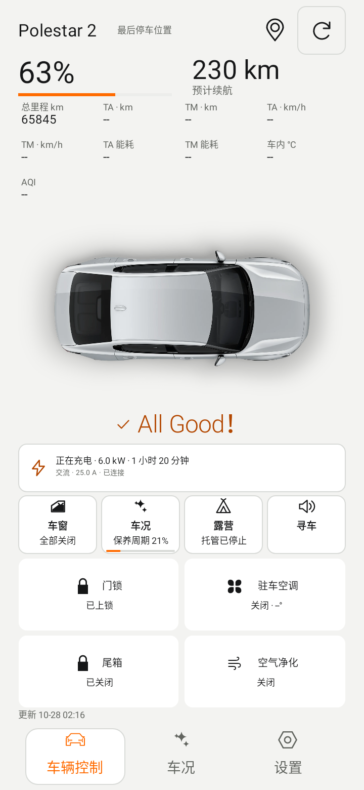
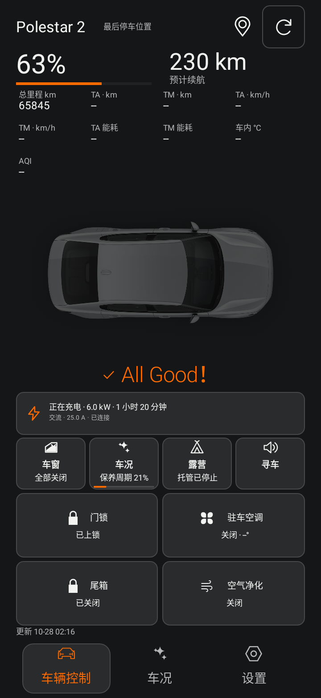
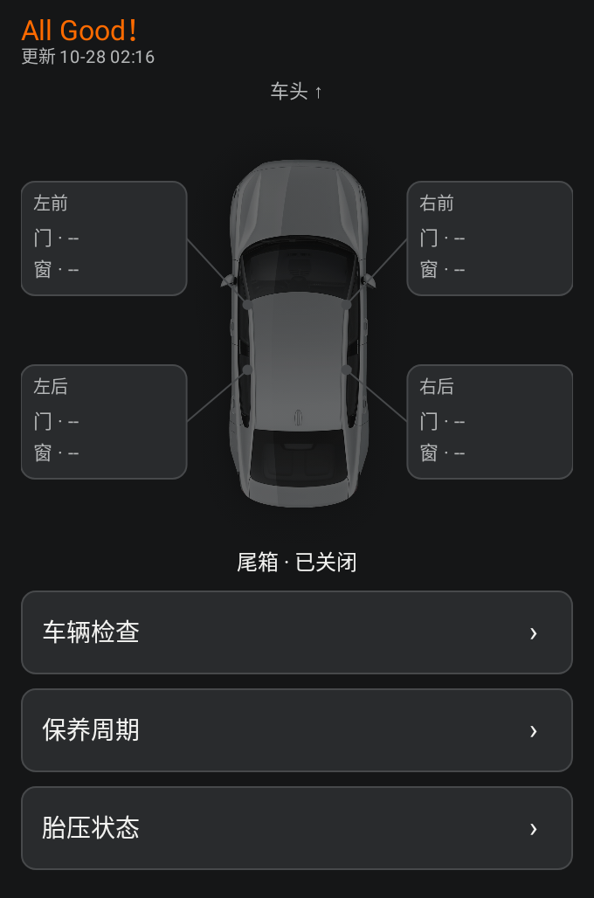

# PsAssistant v0.8.7-beta1

2026-10-28。versionCode **88**，基于v0.8.6-beta1，父提交 `9a3c6434e76af4a8e0c4101873185b343d409ddb`。

## 本次修改

- 修复PS默认关闭状态按钮的暗色背景/文字对比，开启状态仍用VI橙色。车况按钮使用原生TextView文字、图标和跨度，不再依靠自绘文字；文字、百分比、进度条三种模式都保留标题和可点击入口。
- 默认皮肤窗、车况、露营、寻车统一图标槽、行高及标题基线。底部车辆控制、车况、设置均有矢量图标，设置采用细线六角环图形。短横屏允许等比缩小图标，原生实际文字布局按空间收缩，保留原有反馈内容/大小/粗体设置。NIO紧凑车况按钮用百分比摘要，完整保养周期说明保留在详情与无障碍描述。
- 点击所有皮肤的车辆图片恢复车况二级弹窗，内含门窗位置图、健康、胎压和保养展开项；不切换首页。车况按钮仍进入完整页内详情。弹窗订阅实时快照，切换车辆/退出时关闭并移除监听。
- 设置→外观新增光效总开关、All Good！独立开关；原充电光效开关保留。正常状态使用6.4秒轻微文字流光，刷新上限约12fps，复用shader/matrix；无位图或动画SDK。离开前台、隐藏、系统关闭动画或省电模式时停止；弹窗打开时暂停背景文字光效。Widget保持静态。
- 设置→车辆新增实验性空调目标温度，默认关闭、默认22°C。18–28°C / 1°C步进是App实验防护范围，不是车端支持范围声明。主程序、Widget及新建露营会话共用；露营启用时捕获温度，运行中改偏好不改变现有会话。
- 空调按原有5/10/15/20秒只读回查；实验模式只有新鲜API回报温度匹配且运行时才确认成功，缺失/不同/过期回报显示未确认。不把偏好值冒充车辆温度，不自动补发22°C或重试写入；生物验证和取消不发送保持。

## 协议核查与边界

三份上传模板只有两个不同APK。两版均把ClimatizationStart字段3编码为fixed32 float，但所有主程序、Widget和露营调用都固定22.0f。ParkingClimatization字段8为目标温度回报。历史China P2能力记录supportsParkingClimatizationDirectStartSettings=false；Mac分支远控仍unsupported。参数可编码不能证明车辆接受任意温度，因此本次明确为默认关闭的试验。没有执行真实账号登录或实车写指令。

完整签名版仍独立运行，无需安装/导入其他APK；首次协议、生物验证、加密会话、30000km参考保养、只读充电上限、免Key地图、后台/Widget刷新策略全部保留。本地完整APK私有交付；公开CI缺私有配置时仅生成开发验证Debug。

## 验证

本地Debug/Preview测试、Lint、纯Java模型、源文件/知识库一致性及地图JS检查；最终数量在构建验收记录补充。预览为Robolectric原生绘制的合成数据，并非实车截图。OEM启动器、真机大字号/深色系统和车辆温度支持仍需设备验收。

## 本地构建验收

- Debug / Preview各221项测试，0失败、错误、跳过；Lint各0错误、140警告。源码/知识库/纯Java模型/地图JS检查通过。
- 本地完整Release及Preview使用保留签名，未新增SDK/native库；无其他APK依赖。固定证书SHA-256：`cc87b578976ba45bc06219d66a9cce8a771de457785b2af34be76aeaa3768c94`。
- 原包名APK适用于相同签名旧包或首次安装；Preview使用独立包名，可保留旧CI应用及数据并行安装。完整包不经公开GitHub Release分发，私有下载页记录文件校验值。
