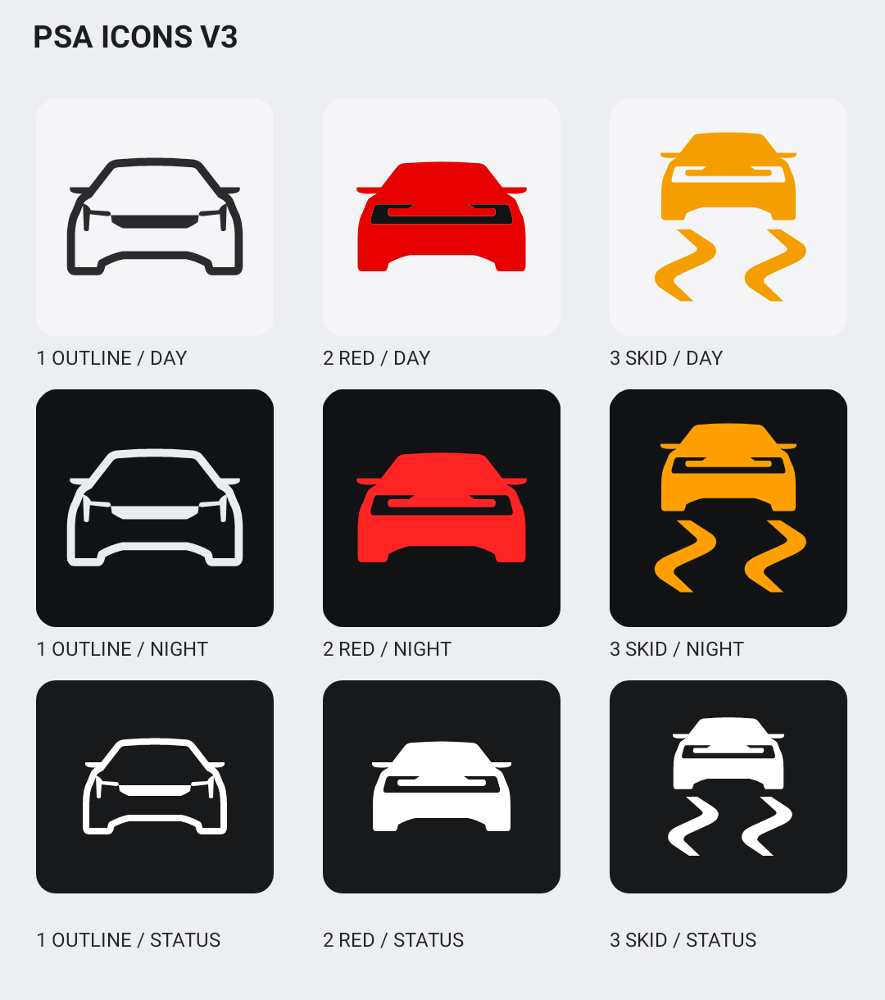
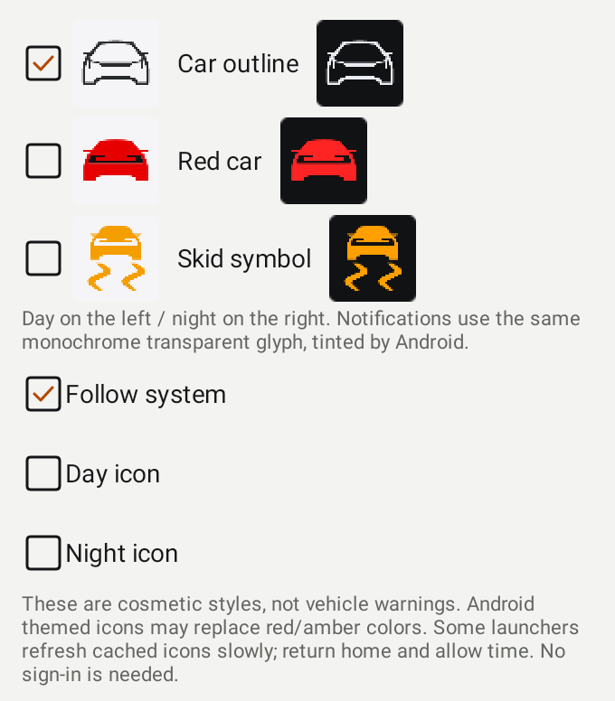
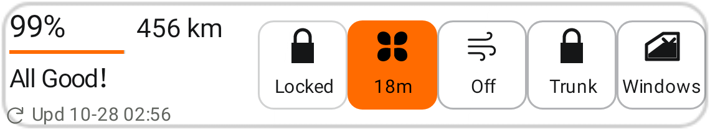
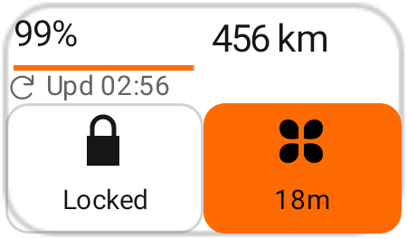
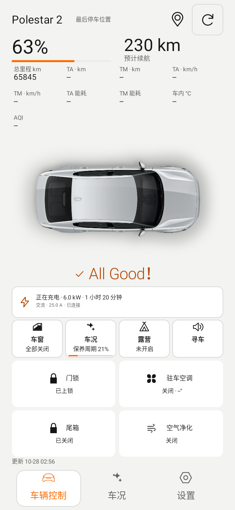

# PsAssistant v0.8.8-beta1

2026-10-28。versionCode **89**，基于v0.8.7-beta1，父提交 `ff052afa1b1735bb13da93bddc813a9e70bb170d`。

## 本次修改

- 新图标家族：车辆轮廓（默认）、红色车辆、防滑图形；每款配齐日间、夜间、透明单色状态栏。设置→外观与交互→程序与通知图标，可独立选择跟随系统/日间/夜间。App品牌标识、控制导航、常驻通知与Widget内标识随选择更新。系统状态栏和Android主题图标可接管颜色，桌面缓存更新时机取决于OEM。
- 启动器切换使用九个稳定alias，MainActivity始终可用，不清除账号、不重启/杀掉进程、不发车辆指令。Android33+原子批量切换，旧系统先开启目标再关闭旧入口。新资源、九份SVG母版及[Psa图标规范v3](Psa_Icon_Design_Specification_v3.md)同步，生成脚本维护唯一几何。
- 所有Widget的空调入口固定同一个风扇图标，颜色仅取已报告车辆状态；不再以关闭风扇替换。运行时按钮显示剩余h/m。固定“开启/停止”动作仍保留动作名称，避免仅靠图标误认操作。
- 剩余时间优先车辆字段3，并按报告时间计算；没有车辆时间时，仅对本App已确认启动且车辆身份匹配的会话采用既有30分钟本地倒计时。无法确定显示--m，已到时显示0m并保留实际运行状态，不假定空调已关闭。数字随Widget重绘更新，数据更新时间始终保留；不增加高频后台请求或定时器服务。
- Widget不再截断为省略号：完整数值按实际宽度测量缩字，辅助标签采用短名称或整项隐藏，充电值不截断，标题/时间/按钮使用原生适配字号。保持48dp控制触区、等比车辆图、透明/PSeu/加粗/字体设置与自选数据。实际容纳不下的自选字段保留设置，以+N提示，点击查看完整详情。
- 默认皮肤露营按钮标题与相邻按钮同基线/字号；状态缩短为未开启、运行中、待检查、停止中、待确认、低电停止或已结束。完整托管原因、时限、检查与电量阈值留在露营详情，后台行为不变。

## 验证边界与交付

新增Android8/15图标切换、唯一启动器与持久恢复、取消不保存、不发远控、日夜颜色与alpha安全区、通知匹配、Widget全皮肤/尺寸/大字体/加粗/中英无省略号/无越界、固定风扇/剩余时间来源和露营标题回归。最终数量见下方验收记录。

完整签名Release与Preview在本地构建，无需安装或导入模板；公开CI缺私有配置时仅生成开发验证Debug。保留原证书；不同签名的旧CI包可保留，并行安装Preview。未执行实车指令；实验目标温度仍默认关闭，OEM启动器/桌面缓存和真机字体需设备验收。

## 本地构建验收

- Debug/Preview各237项测试，0失败/错误/跳过；Lint各0错误、147警告。源码/知识库/Java模型/地图JS检查全部通过。
- Android8/15切换、九个组合唯一入口、保留MainActivity、日夜/透明alpha/中央安全区、通知与选择一致性通过。Widget覆盖六类尺寸/五风格、中英、字体1/1.3/1.56、Widget120%和粗体；新增检查行宽/行高及无省略号，另测窄条/充电值。
- 完整Release/Preview沿用固定证书SHA-256：`cc87b578976ba45bc06219d66a9cce8a771de457785b2af34be76aeaa3768c94`；不新增SDK/native库、后台轮询或写重试。真实车辆与OEM桌面仍需设备验收。

