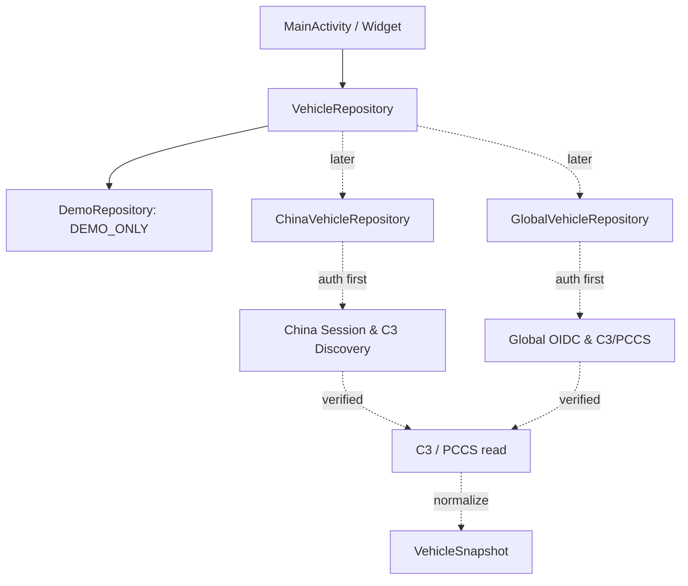

v0.9.5 增量以[KB37](37_V095_UI_EFFECTS_MAP.md)为准：渐隐/吸入气流、简洁2、提前完成回读、免Key地名与试验地图背景，保留现用车图。以下为历史记录。

# 02｜Android 工程与数据架构

## 目标

1. 将原 APK 的 UI / Widget 功能解耦成可维护模块。
2. Android 与 Mac/Hisingen 共用 API 已验证知识，分别编译、分别管理 session，互不回归影响。
3. China / Global 首次启动选择，设置可切换，登录及凭证完全分离。
4. 先离线显示与诊断；后分层接入官方允许且确实已验证的 API。

## 现有 v0.1 实现（IMPLEMENTED_DEMO；编译验证另见 05）

```text
android-app/app/src/main/java/io/github/polestarcn/companion/
  MainActivity.java              主页、车辆、设置、点击反馈、日志复制
  Region.java                    China / Global 区域枚举
  AppState.java                  首次启动选择、区域分离本地命名空间
  VehicleSnapshot.java           统一车辆状态模型
  VehicleRepository.java         数据源接口，便于后期真实接入
  DemoRepository.java            明确标记的模拟车辆数据
  CapabilityMatrix.java          网络 / 远控禁用与功能状态
  DiagnosticLog.java             非敏感事件日志
  VehicleDiagramView.java        简单车身状态示意
  WidgetRenderer.java            标准 / 紧凑控件同源数据
  VehicleWidgetProvider.java     标准控件
  CompactWidgetProvider.java     紧凑控件
```



当前只有实线 `DemoRepository` 完成，虚线是真实 API 待办。首次启动仅保存 `region`，未创建用户凭证。

## 后续建议模块（NOT_IMPLEMENTED）

- `auth/china`, `auth/global`：区域专属账户及会话刷新；不能把 China Web cookie 直接当车辆 API Token。
- `gateway/c3`, `gateway/pccs`：Discovery 主机、gRPC Proto/方法、错误处理与重连。
- `vehicle/model`：差异字段映射、版本化 schema、时间戳/缓存有效期。
- `widget/background`：减少无意义车机唤醒，WorkManager 按系统周期调度。
- `controls`：每条命令独立验证并二次确认；首阶段不开放。
- `diagnostics`：脱敏 request-id、状态码、服务耗时与数据来源标签。

**接口设计**：状态来源显式显示 `DEMO`, `CACHED`, `LIVE`；数据为空时显示 `--`，不伪装成零。不同来源的 SOC/里程不得互相覆盖未记录来源的数值。

## 2026-10-26 结构优化增量（NEW_PROJECT_CODE）

新增 `TelemetryStatus.java` 与 `OperationState.java`，分别负责数据新鲜度及车控结果语义。两者都不包含 HTTP、gRPC、Token 或任何实际远控调用。`DemoRepository` 不再把演示记录设置为当前真实采集时间（设置为 `0L`），UI 明示演示/离线；`tests/ModelStateTest.java` 验证上述不变量。

第三方 APK 报告推荐的完整 MVVM、持久化和多车型能力 **暂未实现**；不把“新增模型类”写成“完成架构重构”。参见 `11_VEHICLE_DATA_DICTIONARY.md` / `12_STAGED_VALIDATION.md`。

## 2026-10-26 / Android Assistant Parity V3.0：目标架构而非现有能力

正式复刻计划以 `14_ANDROID_PARITY_V3_MASTER_PLAN.md` 为准：将参考 APK `PolestarApi` 的认证、C3 读取和车控拆成独立 `auth/`、`api/`、`vehicle/`、`remote/`，并为原版 UI、Widget、Worker 和 diagnostics 建立统一数据/操作状态源。P1/P2/P3 以参考 APK 用户已证实可用的 China 登录、SOC/里程、空调/解锁为优先级；P6 再逐项回归 Global 和 Streaming。

**v0.3.0-alpha2 状态**：China 登录/Token/C3/三项远控适配器已实现并等待用户设备验证；China 快照通过 `VehicleSnapshotStore` 进入首页和 Widget，恢复后强制标为 `CACHED`。Global 仍使用 `DemoRepository`，C3 Live/PCCS/后台 Worker 与其余远控尚未实现。

## v0.4.0-beta1 当前架构

`MainActivity` 合并登录/默认车控/详情/设置；`VehicleCoordinator` 管理应用级队列与状态，供页面和 `VehicleRefreshJob` 共用；`ResidentService` 是可选静默通知，`BootReceiver` 恢复用户启用的后台选项。区域固定中国区；不存在首次区域弹窗。详见 `docs/ANDROID_V04.md`。


## 2026-10-27 v0.7.8 当前增量

新增 VehicleCondition/ServiceReading 汇总层、UiTypography 字体上下文、LocationSnapshot 内存模型；高德 StaticMapPreview 与 SecureMapPreferences 独立，不增加 SDK/后台定位。 具体来源、字段和限制见 [v0.7.8 车况、位置与行程](25_V078_CONDITION_LOCATION_TRIP.md)。


## 2026-10-27 v0.7.9 免 Key 地图增量

当前位置方案改为用户明确选择的内嵌高德官方 URI 网页，移除 staticmap Key 依赖并清理旧配置。参考 APK 仍证明 field1=经度、field2=纬度，未采用外部 AI 文本中的反序定义。c3Lbs 4秒截止、失败隔离及切车/退出结果丢弃已补强；网页需网络和系统 WebView，手机底图/坐标精度仍待实车验收。见 [v0.7.9 知识库](26_V079_KEYLESS_PARKING_WEB.md)。


## 2026-10-27 v0.8.3 当前增量

基于最新v0.8.2/9744759，恢复PS默认并保留VoLike新布局；自动保养只用Health剩余值，历史手动记录不再补充显示。地图共用精简网页，并新增默认关闭的手机前台位置授权；无后台定位。所有Widget改用原生文字/按钮与等比车图，新增PSeu、自选数据、统一粗体/字号及精确尺寸适配。按钮资源和后续迭代参考Psa图标规范v1。协议/实车证据标签不因此升级。详见 [v0.8.3统一知识](28_V083_UI_WIDGET_MAP_ICONS.md)。


## v0.8.4 当前增量 · 2026-10-27

[KB29](29_V084_ICONS_SERVICE_TARGETSOC_READBACK.md)与[更新说明](../docs/Psa_v084_Update.md)记录新母版/昼夜通知、30000km与合并保养周期、C3 TargetSoC只读字段、首次协议、5/10/15/20秒四次回读和非阻塞等待。历史20000km、单次15秒回读与黑武士启动器约定被本轮授权替代。实车TargetSoC/平台桌面昼夜刷新仍待验收。


## v0.8.5 当前更新 · 2026-10-27

[KB30](30_V085_INLINE_CONDITION_STANDALONE.md)记录统一车况入口、页内展开、已报告API优先、设置7组与移除运行时模板依赖。[独立构建](../docs/Psa_Standalone_Build.md)区分完整私有签名包和无配置的公开CI验证包；不把客户端配置值写入公开源码。旧导入流程不再是用户安装步骤。真实账号/实车仍待设备验收。


## v0.8.6 当前增量

参见[KB31](31_V086_UI_WIDGET_REFRESH_POLICIES.md)和[更新说明](../docs/Psa_v086_Update.md)：VoLike合并切换、车况/反馈/字体配置、拖动排序、5×1与自选Widget按钮、Health状态选择、独立刷新策略。车辆c3Lbs与手机定位分开；手机定位只在二级预览按需获取。运行时间h/m无~，计算来源未改变。此前与上述行为不同的说明作为历史记录。完整发行包本地编译签名，无需其他APK。


## v0.8.7 当前增量 · 2026-10-28

原生CenteredStatusButton替代车况/辅助按钮自绘文字，AllGoodTextView只在前台可见绘制。车辆图进入受生命周期管理的carStatusDialog。ClimateTarget统一请求偏好，露营捕获会话目标。


## v0.8.8 当前增量 · 2026-10-28

AppIcons统一alias切换、日夜资源、通知与Widget标识；MainActivity始终启用。WidgetButtons固定风扇与剩余时间，原生数字测量不插入省略号。CampModeManager.compactStatus只影响短按钮文案。


## v0.9.2 当前增量

新增EnergyLog SQLite与EnergyActivity，仅后台串行读写，UI分桶图表。


## v0.9.4 当前增量

VehicleHeroView复用FIT_CENTER车辆和原生Canvas固定池；VehicleEffectsActivity是纯本地模拟页，未接入VehicleCoordinator。详情见KB36。
