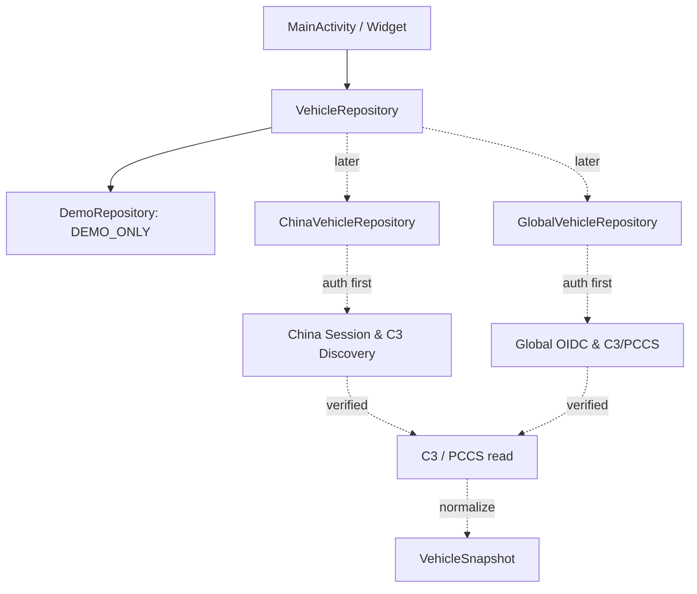

# 02｜Android 工程与数据架构

## 目标

1. 将原 APK 的 UI / Widget 功能解耦成可维护模块。
2. Android 与 Mac/Hisingen 共用 API 已验证知识，分别编译、分别管理 session，互不回归影响。
3. China / Global 首次启动选择，设置可切换，登录及凭证完全分离。
4. 先离线显示与诊断；后分层接入官方允许且确实已验证的 API。

## 现有 v0.1 实现（IMPLEMENTED_DEMO；编译验证另见 05）

```text
android-app/app/src/main/java/io/github/polestarcn/companion/
  MainActivity.java              主页、车辆、设置、点击反馈、日志复制
  Region.java                    China / Global 区域枚举
  AppState.java                  首次启动选择、区域分离本地命名空间
  VehicleSnapshot.java           统一车辆状态模型
  VehicleRepository.java         数据源接口，便于后期真实接入
  DemoRepository.java            明确标记的模拟车辆数据
  CapabilityMatrix.java          网络 / 远控禁用与功能状态
  DiagnosticLog.java             非敏感事件日志
  VehicleDiagramView.java        简单车身状态示意
  WidgetRenderer.java            标准 / 紧凑控件同源数据
  VehicleWidgetProvider.java     标准控件
  CompactWidgetProvider.java     紧凑控件
```



当前只有实线 `DemoRepository` 完成，虚线是真实 API 待办。首次启动仅保存 `region`，未创建用户凭证。

## 后续建议模块（NOT_IMPLEMENTED）

- `auth/china`, `auth/global`：区域专属账户及会话刷新；不能把 China Web cookie 直接当车辆 API Token。
- `gateway/c3`, `gateway/pccs`：Discovery 主机、gRPC Proto/方法、错误处理与重连。
- `vehicle/model`：差异字段映射、版本化 schema、时间戳/缓存有效期。
- `widget/background`：减少无意义车机唤醒，WorkManager 按系统周期调度。
- `controls`：每条命令独立验证并二次确认；首阶段不开放。
- `diagnostics`：脱敏 request-id、状态码、服务耗时与数据来源标签。

**接口设计**：状态来源显式显示 `DEMO`, `CACHED`, `LIVE`；数据为空时显示 `--`，不伪装成零。不同来源的 SOC/里程不得互相覆盖未记录来源的数值。

## 2026-10-26 结构优化增量（NEW_PROJECT_CODE）

新增 `TelemetryStatus.java` 与 `OperationState.java`，分别负责数据新鲜度及车控结果语义。两者都不包含 HTTP、gRPC、Token 或任何实际远控调用。`DemoRepository` 不再把演示记录设置为当前真实采集时间（设置为 `0L`），UI 明示演示/离线；`tests/ModelStateTest.java` 验证上述不变量。

第三方 APK 报告推荐的完整 MVVM、持久化和多车型能力 **暂未实现**；不把“新增模型类”写成“完成架构重构”。参见 `11_VEHICLE_DATA_DICTIONARY.md` / `12_STAGED_VALIDATION.md`。

## 2026-10-26 / Android Assistant Parity V3.0：目标架构而非现有能力

正式复刻计划以 `14_ANDROID_PARITY_V3_MASTER_PLAN.md` 为准：将参考 APK `PolestarApi` 的认证、C3 读取和车控拆成独立 `auth/`、`api/`、`vehicle/`、`remote/`，并为原版 UI、Widget、Worker 和 diagnostics 建立统一数据/操作状态源。P1/P2/P3 以参考 APK 用户已证实可用的 China 登录、SOC/里程、空调/解锁为优先级；P6 再逐项回归 Global 和 Streaming。

**当前代码仍为 `DemoRepository` + `CapabilityMatrix.ENABLE_REMOTE_COMMANDS=false`，尚未接任何真实车辆 API。** 远控是 V3 核心计划，不是目前已实现功能；它也不是被 R8/安全加固延期政策永久排除的功能。
